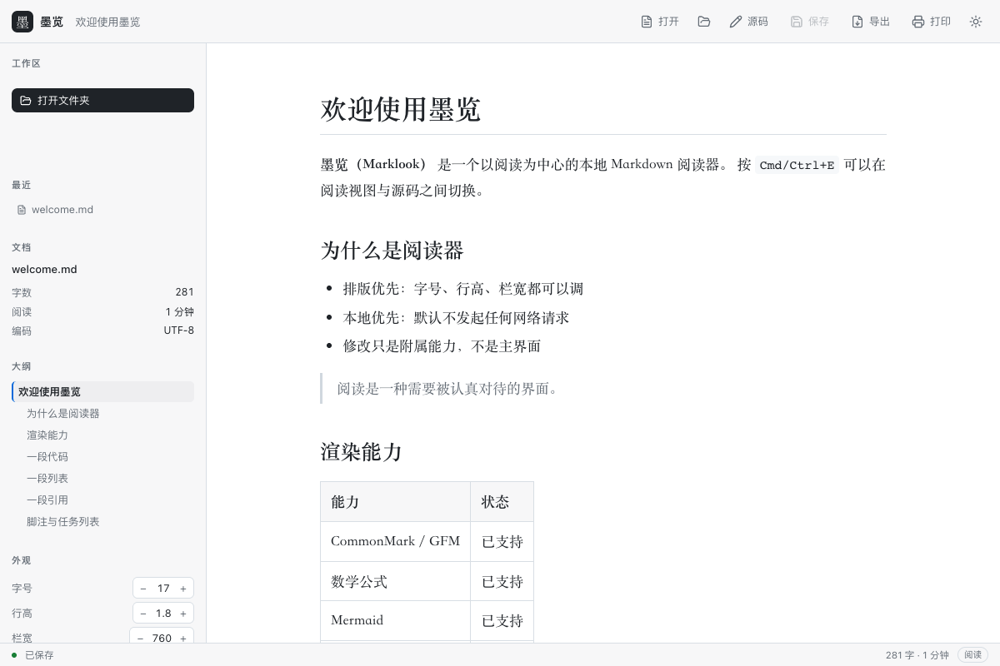

<div align="center">

# 墨览 Marklook

**A reading-first, local-first Markdown reader**

Beautiful typography, quietly reliable · Tauri 2 · macOS & Windows

[](https://github.com/aking1989/Marklook/actions/workflows/ci.yml)
[](https://github.com/aking1989/Marklook/releases)
[](LICENSE)




_Reading view: serif typography, outline follows scroll, word count, adjustable size/line-height/width_

<p>
English | <a href="README.md">简体中文</a>
</p>

</div>

---

Marklook puts reading first: open a Markdown file and get clean, adjustable, distraction-free typography. Press `Cmd/Ctrl+E` to drop into a CodeMirror source view when you need to edit — scroll position and undo history survive the round trip.

No WYSIWYG, no split-pane preview, no cloud. It is local, offline, and built for your own documents.

> The name: **墨 (mò)** means ink — of Markdown and of paper; **览 (lǎn)** means to browse. It is a reader first, an editor second. Chinese typography is a first-class concern.

## ✨ Features

**Reading**

- Full GFM: tables, task lists, footnotes, strikethrough; YAML frontmatter
- Math (KaTeX), syntax highlighting (Shiki, dual light/dark themes follow the app theme), diagrams (Mermaid)
- Outline panel that highlights the current section as you scroll; click to jump
- Fully adjustable typography: font size, line height, content width, serif/sans; light / dark / sepia themes
- One-click code copy, image lightbox, graceful placeholders for broken images

**Editing**

- CodeMirror 6 source mode with a one-keystroke round trip — **position and undo history preserved**
- IME-safe: composing input never triggers global shortcuts
- Paste or drop images — saved into a sibling `assets/` folder and inserted as Markdown
- Large-file mode (> 2MB disables line numbers and decorations to stay smooth)

**Workspace**

- Open a folder to browse it as a library: file tree (respects `.gitignore`), recent files/workspaces
- Cross-file full-text search with Chinese bigram tokenization — searching「编辑」matches「编辑器」; ~140ms to index 1,000 files, ~3ms per query
- File watching keeps the tree fresh
- External modifications: silently reload when you have no unsaved changes (scroll position kept); with unsaved edits, a conflict panel offers overwrite / load from disk / ignore — **your work is never silently lost**

**Data safety**

- Autosave (800ms debounce, can be disabled), atomic writes, CRLF and UTF-8 BOM preserved byte-for-byte
- Crash drafts: persisted every 2 seconds while editing, offered for recovery on reopen

**Export & integration**

- Single-file HTML export (styles, math, highlighting, local images inlined — works offline)
- System print / export to PDF (`Cmd/Ctrl+P`)
- `.md` file association and double-click to open; multiple instances/windows supported (on macOS, files open into the running window)
- Native application menus

## 🔒 Privacy & Security

- **Zero network by default**: no requests are ever made; remote images render as placeholders you can load one by one
- Embedded HTML is sanitized against a whitelist, backed by a strict CSP — a [22-case XSS regression suite](tests/unit/security.test.ts) keeps script injection out
- File access is allowlist-based: only folders/files you explicitly opened (plus their asset directories) are readable; the `mdasset://` protocol serves only image extensions, with path canonicalization and symlink-escape checks

## 📊 Performance

Measured on the development machine (Apple Silicon); benchmarks run continuously with the test suite:

| Metric                                         | Measured    | Budget        |
| ---------------------------------------------- | ----------- | ------------- |
| Cold start to window visible (macOS)           | ~195ms      | < 1s          |
| 100KB document render                          | ~200ms      | < 200ms       |
| Search index (1,000 files) / single query      | 141ms / 3ms | < 2s / < 50ms |
| Typing in a 1MB document (per-transaction p95) | 0.32ms      | < 16ms        |

## ⬇️ Download

Grab an installer from [Releases](https://github.com/aking1989/Marklook/releases):

| Platform                          | File                           | Notes                                 |
| --------------------------------- | ------------------------------ | ------------------------------------- |
| macOS 12+ (Apple Silicon / Intel) | `Marklook_x.y.z_universal.dmg` | Drag to Applications                  |
| Windows 10 22H2+ / 11 (x64)       | `Marklook_x.y.z_x64-setup.exe` | NSIS installer, WebView2 bootstrapped |

Builds are currently unsigned. First launch:

- **macOS**: right-click Marklook.app → Open → Open; or run `xattr -d com.apple.quarantine /Applications/Marklook.app`
- **Windows**: choose "More info → Run anyway" on the SmartScreen prompt

Integrity: see `SHA256SUMS.txt` attached to each release. Plans for signing/notarization: [docs/06-signing.md](docs/06-signing.md) (Chinese).

## ⌨️ Shortcuts

| Shortcut                 | Action                             |
| ------------------------ | ---------------------------------- |
| `Cmd/Ctrl+O`             | Open file                          |
| `Cmd/Ctrl+E`             | Reading view ⇄ source mode         |
| `Cmd/Ctrl+S`             | Save                               |
| `Cmd/Ctrl+P`             | Print / export PDF                 |
| `Cmd/Ctrl+Shift+E`       | Export single-file HTML            |
| `Cmd/Ctrl+=` / `-` / `0` | Bigger / smaller / reset font size |

## 🛠 Building from source

Requirements: Node.js 24+, pnpm 12+, Rust stable (Xcode CLT on macOS; VS Build Tools and WebView2 on Windows).

```bash
git clone https://github.com/aking1989/Marklook.git
cd Marklook
pnpm install

pnpm dev           # in-browser + mock filesystem (no Rust needed, fast UI iteration)
pnpm tauri dev     # desktop app in dev mode
pnpm tauri build   # produce an installer for the current platform
```

## 🧪 Development & testing

```bash
pnpm typecheck && pnpm lint && pnpm format:check
pnpm test              # Vitest: unit + security corpus + perf benchmarks + docs mermaid validation
pnpm test:e2e          # Playwright end-to-end
cd src-tauri
cargo fmt --check && cargo clippy --all-targets -- -D warnings && cargo test
```

- Frontend: 120 Vitest tests (pipeline, search, security corpus, benchmarks, settings, dogfood regressions) + 29 Playwright E2E (Chromium + WebKit, including axe accessibility scans; the WebKit project guards WKWebView-only rendering differences)
- Rust: 52 tests (IO/EOL-BOM round trips, allowlist & path escapes, mdasset protocol, file watching, drafts, mock-runtime IPC integration)
- CI: ubuntu runs the full frontend gate; macOS and Windows run Rust (`.github/workflows/ci.yml`); pushing a `v*` tag builds installers for both platforms and publishes a Release

Design documents live in [docs/](docs/) (Chinese): [architecture](docs/01-architecture.md), [detailed design](docs/02-detailed-design.md), [test plan](docs/03-test-plan.md), [development plan](docs/04-development-plan.md), [PDF verification](docs/05-pdf-verification.md), [signing](docs/06-signing.md), [dogfood log](docs/07-dogfood.md), [multi-tab design](docs/08-multi-tab.md). All diagrams are Mermaid and render inline.

## 🗺 Roadmap

- **v1.1**: tabs (✅ shipped), in-page find, command palette, conflict diff view, custom fonts, auto-update (with signing)
- **v1.2**: `[[wikilink]]` backlinks, tag search, more export formats, print header/footer templates
- Explicitly not planned: WYSIWYG, split-pane preview, cloud sync/collaboration, plugins, mobile

## ⚠️ Known limitations

- **Large documents render slowly**: upstream `remark-parse` parses 1MB-scale mixed documents super-linearly (~9s measured; list-heavy documents are worse). The app degrades gracefully (skips highlighting/math, truncates the outline, warns on open); replacing the parser is under evaluation for v1.1
- Exported HTML does not embed KaTeX fonts (size trade-off); math falls back to system serif fonts offline and remains readable
- The search index is built once when a workspace opens; incremental updates are not implemented yet
- Installers are currently unsigned (see download notes above)

## 🤝 Contributing

Issues and PRs are welcome! Please read [CONTRIBUTING.md](CONTRIBUTING.md) first (setup, commit conventions, definition of done). Especially welcome: rendering bugs on real-world documents (with minimal repro sources), Windows platform issues, and Chinese typography improvements.

## 📄 License

[MIT](LICENSE) © 2026 aking1989 and Marklook contributors

## 🙏 Acknowledgements

Marklook stands on the shoulders of:

[Tauri](https://tauri.app/) · [CodeMirror 6](https://codemirror.net/) · [unified / remark / rehype](https://unifiedjs.com/) · [Shiki](https://shiki.style/) · [Mermaid](https://mermaid.js.org/) · [KaTeX](https://katex.org/) · [MiniSearch](https://lucaong.github.io/minisearch/) · [Zustand](https://zustand.docs.pmnd.rs/)

> This project's own design documents are read and rendered in Marklook — every diagram (Mermaid) is verified through its rendering pipeline.
