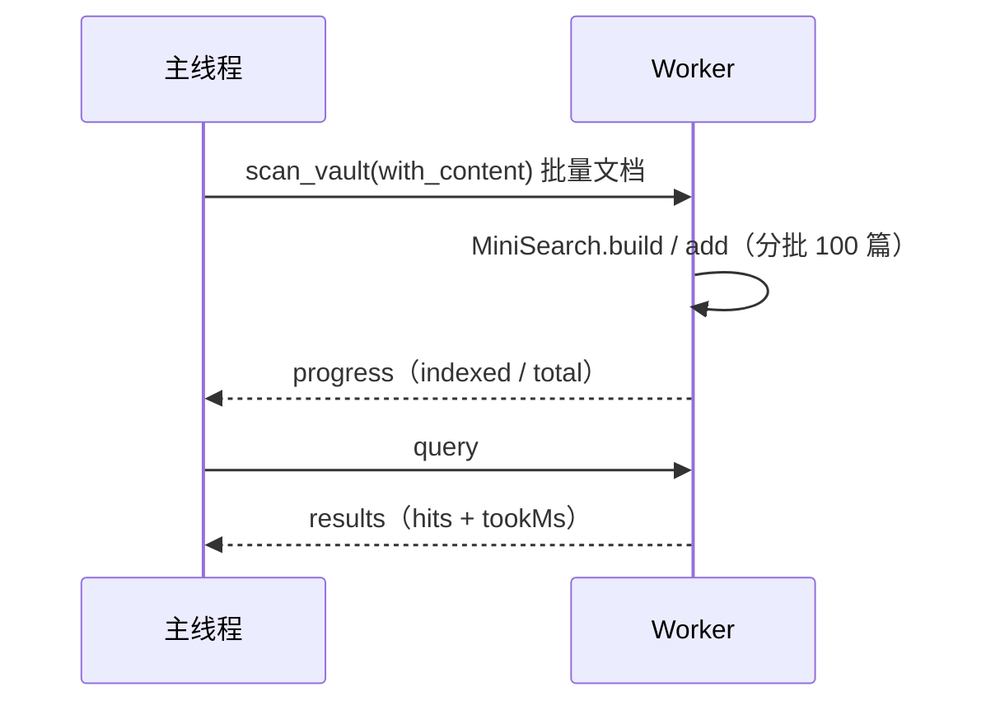
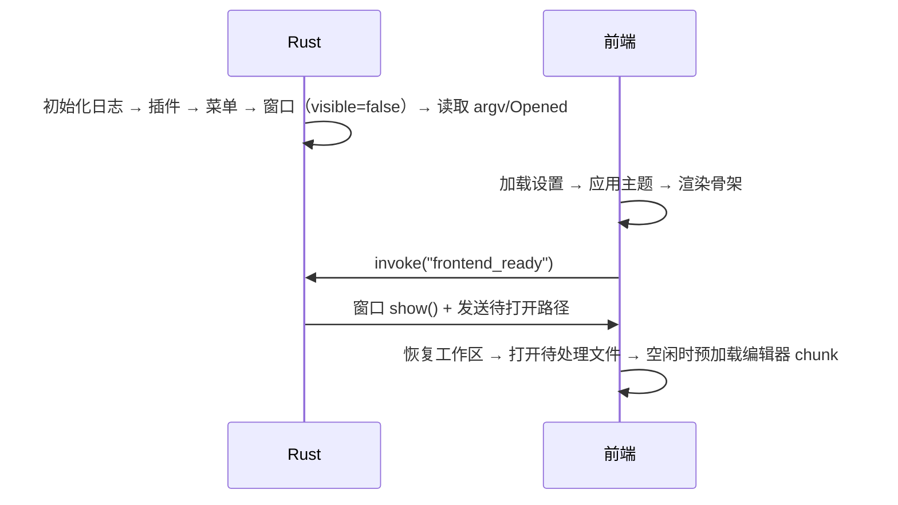

# 墨览（Marklook）详细设计

| 项目 | 内容 |
| --- | --- |
| 文档版本 | v0.1（草案） |
| 日期 | 2026-10-21 |
| 状态 | 待评审 |
| 上游文档 | [概要设计](./01-architecture.md) |
| 关联文档 | [测试方案](./03-test-plan.md) · [开发计划](./04-development-plan.md) |

## 目录

1. [工程结构](#1-工程结构)
2. [平台适配层](#2-平台适配层)
3. [文档模型与状态管理](#3-文档模型与状态管理)
4. [Markdown 渲染管线](#4-markdown-渲染管线)
5. [阅读视图](#5-阅读视图)
6. [源码编辑视图](#6-源码编辑视图)
7. [模式切换与滚动同步](#7-模式切换与滚动同步)
8. [工作区与文件树](#8-工作区与文件树)
9. [大纲与页内导航](#9-大纲与页内导航)
10. [全文搜索](#10-全文搜索)
11. [文件监听、冲突与保存](#11-文件监听冲突与保存)
12. [图片与本地资源](#12-图片与本地资源)
13. [导出与打印](#13-导出与打印)
14. [设置、主题与排版](#14-设置主题与排版)
15. [菜单、快捷键、文件关联与单实例](#15-菜单快捷键文件关联与单实例)
16. [Rust 命令与错误模型](#16-rust-命令与错误模型)
17. [安全设计](#17-安全设计)
18. [性能设计](#18-性能设计)
19. [日志与诊断](#19-日志与诊断)
20. [构建、打包与发布](#20-构建打包与发布)
21. [兼容性与降级策略](#21-兼容性与降级策略)
22. [扩展点](#22-扩展点)

---

## 1. 工程结构

### 1.1 完整目录

```text
marklook/
├── docs/                          # 本组文档
├── src/
│   ├── main.tsx
│   ├── app/
│   │   ├── App.tsx
│   │   ├── Layout.tsx
│   │   ├── ErrorBoundary.tsx
│   │   ├── commandRegistry.ts     # 命令注册与菜单事件分发
│   │   └── providers/
│   │       ├── ThemeProvider.tsx
│   │       └── ToastProvider.tsx
│   ├── features/
│   │   ├── document/
│   │   │   ├── documentStore.ts
│   │   │   ├── DocumentSession.ts
│   │   │   ├── openDocument.ts
│   │   │   ├── saveDocument.ts
│   │   │   ├── conflict.ts
│   │   │   └── drafts.ts
│   │   ├── reader/
│   │   │   ├── ReaderView.tsx
│   │   │   ├── useMermaidRender.ts
│   │   │   ├── readerFind.ts
│   │   │   ├── Lightbox.tsx
│   │   │   └── codeCopy.ts
│   │   ├── editor/
│   │   │   ├── EditorViewHost.tsx
│   │   │   ├── editorSession.ts
│   │   │   ├── extensions.ts
│   │   │   ├── theme.ts
│   │   │   ├── keymap.ts
│   │   │   └── pasteImage.ts
│   │   ├── workspace/
│   │   │   ├── workspaceStore.ts
│   │   │   ├── FileTree.tsx
│   │   │   ├── RecentList.tsx
│   │   │   └── treeModel.ts
│   │   ├── outline/
│   │   │   ├── OutlinePanel.tsx
│   │   │   └── outlineModel.ts
│   │   ├── search/
│   │   │   ├── search.worker.ts
│   │   │   ├── searchClient.ts
│   │   │   ├── SearchPanel.tsx
│   │   │   └── tokenizer.ts
│   │   ├── export/
│   │   │   ├── exportHtml.ts
│   │   │   ├── print.ts
│   │   │   └── template.ts
│   │   └── settings/
│   │       ├── settingsStore.ts
│   │       ├── SettingsPanel.tsx
│   │       └── schema.ts
│   ├── markdown/
│   │   ├── pipeline.ts
│   │   ├── schema.ts
│   │   ├── types.ts
│   │   ├── cache.ts
│   │   └── plugins/
│   │       ├── remarkCollect.ts
│   │       ├── rehypeResolveUrls.ts
│   │       ├── rehypeMermaid.ts
│   │       ├── rehypeShiki.ts
│   │       ├── rehypeTableWrap.ts
│   │       └── rehypeExportIds.ts
│   ├── platform/
│   │   ├── types.ts
│   │   ├── tauri.ts
│   │   ├── mock.ts
│   │   └── index.ts
│   ├── stores/
│   │   └── uiStore.ts
│   ├── lib/
│   │   ├── lineMap.ts
│   │   ├── hash.ts
│   │   ├── debounce.ts
│   │   ├── paths.ts
│   │   └── time.ts
│   ├── styles/
│   │   ├── tokens.css             # 设计变量与三套主题
│   │   ├── base.css
│   │   ├── reader.css             # 阅读与打印共用
│   │   ├── editor.css
│   │   └── app.css
│   └── i18n/
│       └── zh-CN.ts
├── src-tauri/
│   ├── src/
│   │   ├── main.rs
│   │   ├── lib.rs
│   │   ├── state.rs
│   │   ├── commands/
│   │   │   ├── mod.rs
│   │   │   ├── dialog.rs
│   │   │   ├── document.rs
│   │   │   ├── vault.rs
│   │   │   ├── watch.rs
│   │   │   ├── asset.rs
│   │   │   ├── export.rs
│   │   │   ├── draft.rs
│   │   │   └── system.rs
│   │   ├── io/
│   │   │   ├── mod.rs
│   │   │   ├── atomic.rs
│   │   │   └── text.rs
│   │   ├── scan/
│   │   │   └── mod.rs
│   │   ├── watch/
│   │   │   └── mod.rs
│   │   ├── assets/
│   │   │   └── protocol.rs
│   │   ├── open.rs
│   │   ├── menu.rs
│   │   └── logging.rs
│   ├── Cargo.toml
│   ├── tauri.conf.json
│   └── capabilities/default.json
├── tests/
│   ├── unit/
│   ├── e2e/
│   └── fixtures/
│       ├── docs/
│       ├── vault/
│       └── security/
├── playwright.config.ts
├── vitest.config.ts
├── package.json
├── pnpm-lock.yaml
└── README.md
```

### 1.2 依赖清单

前端运行时：

| 包 | 用途 |
| --- | --- |
| `react`, `react-dom` | UI |
| `zustand` | 状态 |
| `@tauri-apps/api`, `@tauri-apps/plugin-store` | IPC 与设置持久化 |
| `@codemirror/state`, `@codemirror/view`, `@codemirror/commands`, `@codemirror/language`, `@codemirror/search`, `@codemirror/lang-markdown`, `@codemirror/language-data` | 编辑器 |
| `unified`, `remark-parse`, `remark-gfm`, `remark-math`, `remark-frontmatter`, `remark-rehype` | 解析 |
| `rehype-raw`, `rehype-sanitize`, `rehype-katex`, `rehype-stringify` | 净化与输出 |
| `katex` | 数学 |
| `shiki`, `@shikijs/rehype`, `@shikijs/langs` | 代码高亮 |
| `mermaid` | 图表 |
| `minisearch` | 搜索 |
| `yaml` | frontmatter |
| `github-slugger`, `mdast-util-to-string`, `unist-util-visit`, `hast-util-to-string` | AST 工具 |
| `lucide-react`, `clsx` | 图标与类名 |

Rust 依赖：

| crate | 用途 |
| --- | --- |
| `tauri` 2.12 | 外壳 |
| `tauri-plugin-dialog` 2 | 原生对话框（Rust 侧调用） |
| `tauri-plugin-store` 2 | 设置持久化 |
| `tauri-plugin-window-state` 2 | 窗口尺寸位置 |
| `tauri-plugin-single-instance` 2 | 单实例 |
| `tauri-plugin-opener` 2 | 外链与在文件夹中显示 |
| `notify`, `notify-debouncer-mini` | 文件监听 |
| `ignore` | 目录遍历 |
| `serde`, `serde_json` | 序列化 |
| `thiserror` | 错误 |
| `sha2`, `base64` | 草稿命名 / 路径编码 |
| `dunce` | Windows 规范化路径 |
| `tempfile` | 原子写临时文件 |
| `tracing`, `tracing-subscriber`, `tracing-appender` | 日志 |

### 1.3 npm scripts

```json
{
  "scripts": {
    "dev": "vite",
    "build": "tsc --noEmit && vite build",
    "tauri": "tauri",
    "tauri:dev": "tauri dev",
    "tauri:build": "tauri build",
    "typecheck": "tsc --noEmit",
    "lint": "eslint . && prettier --check .",
    "format": "eslint . --fix && prettier --write .",
    "test:unit": "vitest run",
    "test:unit:watch": "vitest",
    "test:e2e": "playwright test",
    "test:rust": "cargo test --manifest-path src-tauri/Cargo.toml",
    "check": "pnpm typecheck && pnpm lint && pnpm test:unit && pnpm test:rust"
  }
}
```

---

## 2. 平台适配层

### 2.1 目标

UI 与原生能力之间只有一个接口。好处：

- Playwright / 浏览器调试使用内存 Mock，不依赖 Tauri。
- 若未来迁回 Electron，只替换实现。
- 所有 IPC 错误在边界处归一化，业务层不处理裸字符串错误。

### 2.2 类型定义

```ts
// src/platform/types.ts
export type Eol = 'lf' | 'crlf';

export interface FileStat {
  path: string;
  size: number;
  mtimeMs: number;
  isFile: boolean;
  isDir: boolean;
}

export interface TextDocument {
  path: string;
  content: string;
  mtimeMs: number;
  size: number;
  eol: Eol;
  bom: boolean;
  encoding: 'utf-8';
}

export interface WriteOptions {
  expectedMtimeMs: number | null; // null 表示新建 / 另存为
  force?: boolean;               // 冲突解决时强制覆盖
  eol: Eol;
  bom: boolean;
}

export interface WriteResult {
  mtimeMs: number;
  size: number;
  eol: Eol;
  bom: boolean;
}

export interface DirEntry {
  name: string;
  path: string;
  isDir: boolean;
  size: number;
  mtimeMs: number;
}

export interface VaultEntry extends DirEntry {
  content?: string;       // scan_vault(with_content=true) 时返回
  truncated?: boolean;    // 文件超过索引上限时为 true
}

export interface VaultScan {
  root: string;
  entries: VaultEntry[];
  truncated: boolean;     // 条目数超过上限
  totalFiles: number;
  skipped: number;
}

export interface FsChangeEvent {
  kind: 'create' | 'modify' | 'remove' | 'rename';
  paths: string[];
  at: number;
}

export interface AssetResult {
  absPath: string;
  relPath: string;        // 相对于文档目录，已 encodeURI
  size: number;
}

export interface WatchHandle {
  id: number;
  close(): Promise<void>;
}

export type Unsubscribe = () => void;

export interface Platform {
  // 对话框：Rust 负责弹出并把选择结果加入 allowlist
  pickFile(): Promise<string | null>;
  pickFolder(): Promise<string | null>;

  // 文档读写
  readDocument(path: string): Promise<TextDocument>;
  writeDocument(path: string, content: string, opts: WriteOptions): Promise<WriteResult>;
  saveDocumentAs(suggestedName: string, content: string): Promise<TextDocument | null>;
  stat(path: string): Promise<FileStat>;

  // 工作区
  scanVault(root: string, withContent: boolean): Promise<VaultScan>;
  listDir(path: string): Promise<DirEntry[]>;

  // 监听
  watchPaths(paths: string[], recursive: boolean): Promise<WatchHandle>;
  onFsChange(cb: (e: FsChangeEvent) => void): Unsubscribe;

  // 资源
  assetUrl(absPath: string, mtimeMs?: number): string;
  saveAsset(docPath: string, fileName: string, bytes: Uint8Array): Promise<AssetResult>;
  readAssetBytes(absPath: string): Promise<Uint8Array>;

  // 导出与打印
  exportHtml(suggestedName: string, html: string): Promise<string | null>;
  print(): Promise<void>;

  // 系统
  openExternal(url: string): Promise<void>;
  revealInFolder(path: string): Promise<void>;

  // 文件关联
  takePendingOpen(): Promise<string[]>;
  onOpenPaths(cb: (paths: string[]) => void): Unsubscribe;

  appVersion(): Promise<string>;
}
```

### 2.3 Tauri 实现要点

- 所有 `invoke` 包一层 `call<T>()`：捕获错误、转换为 `PlatformError`、统一日志。
- 事件监听只注册一次，`onFsChange` 内部维护订阅者集合，避免多次 `listen`。
- `assetUrl` 使用 base64url 编码绝对路径，并附加 `?mtime=` 以刷新图片缓存：

```ts
function assetUrl(absPath: string, mtimeMs?: number) {
  const token = base64UrlEncodeUtf8(absPath);
  const q = mtimeMs ? `?v=${Math.floor(mtimeMs)}` : '';
  return `mdasset://local/${token}${q}`;
}
```

Windows 上自定义协议实际 URL 形如 `http://mdasset.localhost/local/<token>`，由 Tauri 转换；前端统一调用 `convertFileSrc` 或平台实现内部处理，不直接拼字符串。

### 2.4 Mock 实现

`MockPlatform` 使用 `Map<string, MockFile>` 模拟文件系统：

```ts
interface MockFile {
  content: string;
  mtimeMs: number;
  eol: Eol;
  bom: boolean;
}
```

- 通过 URL 参数 `?platform=mock&fixture=vault-basic` 启用。
- 支持在 E2E 中通过 `window.__mockFs` 注入、修改、删除文件，模拟外部修改。
- `watchPaths` 在 Mock 中即时触发事件，便于测试冲突流程。
- Playwright 直接访问 `vite` 开发服务器，不启动 Tauri，因此 macOS 也能跑完整 E2E。

### 2.5 错误归一化

```ts
export type PlatformErrorCode =
  | 'NOT_FOUND' | 'PERMISSION_DENIED' | 'INVALID_UTF8' | 'CONFLICT'
  | 'IO' | 'PATH_OUTSIDE_ROOT' | 'TOO_LARGE' | 'UNSUPPORTED' | 'CANCELLED';

export class PlatformError extends Error {
  constructor(public code: PlatformErrorCode, message: string, public detail?: string) {
    super(message);
  }
}
```

`CANCELLED` 用于用户关闭对话框，不提示错误。

---

## 3. 文档模型与状态管理

### 3.1 文档会话数据结构

```ts
// src/features/document/DocumentSession.ts
export type DocMode = 'read' | 'edit';
export type DocStatus =
  | 'empty' | 'loading' | 'clean' | 'dirty' | 'saving' | 'conflict' | 'error';

export interface DocumentSession {
  path: string | null;
  content: string;             // 阅读态权威内容
  savedContent: string;        // 上次成功保存/加载的内容
  baselineMtimeMs: number | null;
  eol: Eol;
  bom: boolean;
  mode: DocMode;
  status: DocStatus;
  outline: OutlineItem[];
  render: RenderResult | null;
  readAnchorLine: number;
  editAnchorLine: number;
  conflict: ConflictInfo | null;
  error: PlatformError | null;
  isLarge: boolean;
  stats: { charCount: number; wordCount: number; readingMinutes: number };
}

export interface ConflictInfo {
  diskMtimeMs: number;
  baselineMtimeMs: number;
  diskSize: number;
  detectedAt: number;
}
```

### 3.2 Store 与编辑器的关系

编辑模式下 **CodeMirror 的 `EditorState` 是内容的权威来源**。`documentStore.content` 只在以下时刻由编辑器同步：

1. 停止输入 300ms 后（用于状态栏字数、脏状态判断、自动保存计时）。
2. 模式切回阅读前。
3. 保存 / 另存为 / 导出前。
4. 窗口关闭确认前。

禁止在 `EditorView.updateListener` 里每次变更都 `setState`，否则大文档输入会触发整棵 React 树重渲染。

`EditorHost` 暴露：

```ts
export interface EditorHandle {
  getValue(): string;
  setValue(value: string, opts?: { keepHistory?: boolean }): void;
  getCursorLine(): number;
  getTopVisibleLine(): number;
  scrollToLine(line: number, opts?: { focus?: boolean }): void;
  focus(): void;
  destroy(): void;
}
```

### 3.3 文档操作流程

#### 打开

```ts
async function openDocument(path: string) {
  await ensureNoUnsavedChanges();
  setStatus('loading');
  const doc = await platform.readDocument(path);
  const draft = await drafts.load(path);
  setState({
    path, content: doc.content, savedContent: doc.content,
    baselineMtimeMs: doc.mtimeMs, eol: doc.eol, bom: doc.bom,
    mode: 'read', status: 'clean', render: null, conflict: null,
  });
  if (draft && draft.savedAt > doc.mtimeMs && draft.content !== doc.content) {
    showRestoreDraftBanner(draft);
  }
  const result = await renderMarkdown({ source: doc.content, docPath: path, ... });
  setRender(result);
  await platform.watchPaths([path], false);
}
```

#### 脏状态判定

```ts
function recomputeDirty(content: string, savedContent: string) {
  return content !== savedContent;
}
```

不做 hash 比较，直接字符串比较（V8/JavaScriptCore 对同长字符串有快速路径；1MB 文档比较耗时约 1ms，可接受）。

#### 保存

```ts
async function save(force = false) {
  const content = editor?.getValue() ?? state.content;
  if (!state.path) return saveAs();
  if (content === state.savedContent && !force) return;
  setStatus('saving');
  try {
    const result = await platform.writeDocument(state.path, content, {
      expectedMtimeMs: state.baselineMtimeMs,
      force,
      eol: state.eol,
      bom: state.bom,
    });
    rememberOwnWrite(state.path, result.mtimeMs);
    await drafts.remove(state.path);
    setState({
      savedContent: content, baselineMtimeMs: result.mtimeMs,
      status: 'clean', conflict: null,
    });
  } catch (e) {
    if (e instanceof PlatformError && e.code === 'CONFLICT') {
      setConflict(await readConflictInfo(state.path));
      setStatus('conflict');
    } else {
      setStatus('dirty');
      toast.error(errorMessage(e));
    }
  }
}
```

#### 冲突解决

| 用户选择 | 行为 |
| --- | --- |
| 重新加载 | 读取磁盘内容，替换编辑器和 store，重置撤销历史，`clean` |
| 保留本地并覆盖 | `save(force = true)` |
| 另存为 | 打开保存对话框，写入新路径，当前会话切换到新文档 |
| 查看磁盘内容 | v1.1，展示只读对比 |

#### 关闭 / 退出

- 窗口 `onCloseRequested`：若有未保存内容，阻止关闭并弹出三选一（保存 / 不保存 / 取消）。
- macOS `Cmd+Q`：Rust 拦截退出，通知前端走同一流程；前端调用 `confirm_quit` 后 Rust 真正退出。
- 草稿在关闭前立即落盘，防止"不保存"误操作后无法找回（草稿保留 7 天）。

### 3.4 自动保存

- 默认开启，停止输入 800ms 后触发。
- 仅在 `dirty && !conflict && path != null` 时执行。
- 保存失败不重试轰炸，状态栏显示"保存失败"，用户可手动重试。
- 自动保存不改变撤销历史，不移动光标。
- 大文件（> 5MB）自动保存间隔提高到 3s，避免频繁写盘。

### 3.5 草稿恢复

- 编辑态每 2s 去抖写入草稿；草稿内容为当前编辑器内容。
- 存储位置：应用数据目录 `drafts/<sha256(canonicalPath)>.json`。
- 结构：

```ts
interface DraftRecord {
  path: string;
  content: string;
  baselineMtimeMs: number;
  savedAt: number;
  version: 1;
}
```

- 打开文档时若草稿比磁盘新且内容不同，顶部显示"发现未保存的修改，是否恢复？"，提供"恢复 / 丢弃"。
- 保存成功、用户明确丢弃、文档关闭且干净时删除草稿。
- 启动时清理 7 天前的草稿；单条草稿上限 20MB，超过则不写草稿并提示。

---

## 4. Markdown 渲染管线

### 4.1 总体流程

渲染是一个异步纯函数：

```ts
renderMarkdown(input: RenderInput): Promise<RenderResult>
```

处理顺序（顺序不可随意调换）：

| # | 阶段 | 作用 | 信任级别 |
| --- | --- | --- | --- |
| 1 | 预处理 | 统一换行、超大文件判定、能力探测（是否含公式/代码/mermaid） | — |
| 2 | `remark-parse` | Markdown → mdast | 不可信输入 |
| 3 | `remark-gfm` | 表格、任务列表、删除线、自动链接、脚注 | 不可信输入 |
| 4 | `remark-math` | `$...$` / `$$...$$` → math 节点 | 不可信输入 |
| 5 | `remark-frontmatter` | YAML frontmatter 独立节点 | 不可信输入 |
| 6 | `remarkCollect`（自定义） | 收集大纲、frontmatter、字数；给顶层块加行号属性 | 不可信输入 |
| 7 | `remark-rehype` | mdast → hast（`allowDangerousHtml: true`） | 不可信输入 |
| 8 | `rehype-raw` | 解析内嵌 HTML | 不可信输入 |
| 9 | `rehype-sanitize` | **安全边界**：移除脚本、事件、危险协议 | 不可信 → 可信 |
| 10 | `rehype-katex` | 数学渲染（`throwOnError: false`） | 可信生成 |
| 11 | `rehype-shiki` | 代码高亮（按需加载语言） | 可信生成 |
| 12 | `rehype-mermaid`（自定义） | mermaid 代码块 → 占位节点 | 可信生成 |
| 13 | `rehype-resolve-urls`（自定义） | 相对链接/图片、外链标记、锚点标记 | 可信生成 |
| 14 | `rehype-table-wrap`（自定义） | 表格外包横向滚动容器 | 可信生成 |
| 15 | `rehype-stringify` | hast → HTML 字符串 | 可信输出 |

> 关键原则：**sanitize 只处理用户可控内容；KaTeX、Shiki、Mermaid 的输出在 sanitize 之后注入**，因此不必为它们的复杂 `style`/`class`/MathML 放宽 schema。

### 4.2 输入输出类型

```ts
// src/markdown/types.ts
export interface RenderInput {
  source: string;
  docPath: string | null;
  options?: Partial<RenderOptions>;
  /** 绝对路径 → 资源 URL（Tauri 下为 mdasset://），由平台层注入，管线保持纯函数。 */
  resolveAsset?: (absolutePath: string) => string;
}

export interface OutlineItem {
  id: string;        // 稳定 slug，用于导出锚点
  depth: number;     // 1–6
  text: string;
  line: number;
  children: OutlineItem[];
}

export interface RenderWarning {
  kind: 'frontmatter' | 'math' | 'mermaid' | 'highlight' | 'link' | 'image';
  message: string;
  line?: number;
}

export interface RenderResult {
  html: string;
  outline: OutlineItem[];       // 扁平列表，children 为空；树在 UI 层构建
  frontmatter: Record<string, unknown>;
  title: string;
  meta: { charCount: number; wordCount: number; readingMinutes: number };
  warnings: RenderWarning[];
}
```

### 4.3 管线组装

能力探测采用保守扫描（跳过代码围栏内容），避免为不含数学的文档加载 KaTeX。以下为 M1 实现要点（与初稿的差异已在实现注记中标注）：

```ts
// src/markdown/detect.ts
export function detectCapabilities(source: string) {
  const noFences = source.replace(/```[\s\S]*?```|~~~[\s\S]*?~~~/g, '');
  return {
    math: /\$\$[\s\S]+?\$\$|(^|[^\\$])\$[^$\n]+\$/m.test(noFences),
    mermaid: /^```\s*mermaid\b/m.test(source),
    code: /^(```|~~~)/m.test(source),
  };
}

// src/markdown/pipeline.ts（示意，省略缓存与收集细节）
export async function renderMarkdown(input: RenderInput): Promise<RenderResult> {
  const options = { ...defaultRenderOptions(), ...input.options };
  const capabilities = detectCapabilities(input.source);

  // 渲染结果 LRU(8) 缓存：key = docPath + options 快照 + source，命中直接返回。

  const processor = unified()
    .use(remarkParse)
    .use(remarkGfm)
    .use(remarkFrontmatter, ['yaml']);

  if (options.enableMath) processor.use(remarkMath); // 关闭时 $ 保持字面

  processor
    .use(remarkCollect, { outline, slugger, frontmatter, warnings })
    .use(remarkRehype, { allowDangerousHtml: true });

  // 性能：无 "<" 的文档不可能含内嵌 HTML，跳过 serialize+parse5 重解析。
  if (input.source.includes('<')) processor.use(rehypeRaw);

  processor.use(rehypeSanitize, sanitizeSchema);

  if (options.enableMath && capabilities.math) {
    const { default: rehypeKatex } = await import('rehype-katex');
    processor.use(rehypeKatex); // v7 固定不抛错，无 throwOnError 选项
  }
  if (options.enableHighlight && capabilities.code && !options.largeFileMode) {
    const { rehypeShiki } = await import('./plugins/rehypeShiki');
    processor.use(rehypeShiki, { warnings }); // 双主题内置，theme 参数只影响输出端
  }
  if (options.enableMermaid && capabilities.mermaid) {
    const { rehypeMermaid } = await import('./plugins/rehypeMermaid');
    processor.use(rehypeMermaid);
  }

  processor
    .use(rehypeResolveUrls, {
      docPath: input.docPath,
      allowRemoteImages: options.allowRemoteImages,
      resolveAsset: input.resolveAsset, // 平台层注入：Tauri → mdasset://
      forExport: options.forExport,
    })
    .use(rehypeTableWrap)
    .use(rehypeStringify);

  const file = await processor.process(input.source);
  /* ...组装 RenderResult（outline/frontmatter/title/meta/warnings）... */
}
```

> **实现注记（2026-10-23，M1 落地）**
>
> - `remarkCollect` 收集结果通过闭包返回，不经 `file.data`（避免 vFile 数据在 rehype 阶段的类型断言）。
> - `remark-math` v6 的占位 class 是 `language-math`（加 `math-inline`/`math-display`），sanitize schema 已同步放行（§4.5）。
> - `rehype-katex` v7 无 `throwOnError` 选项，行为固定为单条失败渲染错误文本。
> - 行号锚点属性在 hast 树中有 camelCase（经 rehypeRaw/parse5）与 kebab-case（直连）两种形态，插件读取时统一兼容（`plugins/lineAnchors.ts`）。

### 4.4 `remarkCollect`

职责：

1. 遍历所有 `heading`，提取纯文本（`mdast-util-to-string`）、层级、行号，用 `github-slugger` 生成唯一 slug。
2. 收集顶层块的行号，写入 `node.data.hProperties`，使 HTML 元素带 `data-line-start` / `data-line-end`。
3. 解析 frontmatter（`yaml` 包），失败时降级为空对象并记 warning。
4. 计算字数：CJK 字符逐字计数，拉丁文按 `\b[\p{L}\p{N}]+\b` 计词；阅读时间 `ceil(cjk/400 + words/220)`。

```ts
visit(tree, (node) => {
  if (node.type === 'heading' && node.position) {
    const text = toString(node).trim();
    outline.push({
      id: slugger.slug(text || 'section'),
      depth: node.depth,
      text,
      line: node.position.start.line,
    });
  }
});

visit(tree, (node, _index, parent) => {
  if (parent?.type !== 'root' || !node.position) return;
  node.data ??= {};
  node.data.hProperties = {
    ...node.data.hProperties,
    'data-line-start': node.position.start.line,
    'data-line-end': node.position.end.line,
  };
});
```

只给顶层块加锚点是有意为之：嵌套块锚点会让 line-map 出现重叠，收益小于复杂度。高度很大的块（长代码块、长列表）在映射时按比例插值，视觉同步足够。

### 4.5 Sanitize schema

以 `hast-util-sanitize` 的 GitHub schema 为基础，做以下调整：

```ts
export const schema: Schema = {
  ...defaultSchema,
  clobberPrefix: '', // 见说明
  attributes: {
    ...defaultSchema.attributes,
    '*': [
      ...(defaultSchema.attributes?.['*'] ?? []),
      'data-line-start',
      'data-line-end',
    ],
    code: [
      ...(defaultSchema.attributes?.code ?? []),
      ['className', /^language-./],
    ],
    span: [
      ...(defaultSchema.attributes?.span ?? []),
      // remark-math v6 的占位 class；KaTeX 在 sanitize 之后注入最终结果
      ['className', 'language-math', 'math', 'math-inline', 'math-display'],
    ],
    input: [['type', 'checkbox'], 'checked', 'disabled'],
    a: [...(defaultSchema.attributes?.a ?? []), 'data-internal-doc', 'data-anchor', 'data-external'],
    img: [...(defaultSchema.attributes?.img ?? []), 'data-abs-src', 'data-remote-src'],
  },
  protocols: {
    href: ['http', 'https', 'mailto'],
    src: ['mdasset', 'http', 'https'],
  },
  tagNames: [
    ...(defaultSchema.tagNames ?? []),
    'details', 'summary', 'del', 'input', 'kbd', 'mark', 'sup', 'sub',
  ],
};
```

说明：

- `clobberPrefix: ''` 是安全的：应用不使用 `getElementById` 定位自身关键节点；页内锚点在应用内通过大纲的 slug/行号解析，不依赖 DOM id。导出的 HTML 由 `rehypeExportIds` 单独添加 id。
- 禁止 `style` 属性、`class` 通配（除白名单）、`iframe`、`object`、`embed`、`script`、`form`、`base`。
- `data:` 不允许出现在用户内容中，避免超大内联图片或脚本；图片资源走 `mdasset://`。
- 原始 HTML 中的 `href` 若为相对路径保留，后续由 `rehypeResolveUrls` 处理。

### 4.6 行号锚点

- 顶层块元素带 `data-line-start="N"` / `data-line-end="M"`。
- Mermaid 占位块需要携带原始代码块的起始行，供滚动映射使用。
- 行号来自 mdast 的 `position`，对 CRLF 文件同样正确（micromark 按行计数）。

### 4.7 代码高亮

- 单例 highlighter，首次遇到代码块时初始化；使用 Shiki 的 Oniguruma WASM 引擎（精度优先）。
- 预置语言：`javascript, typescript, jsx, tsx, json, bash, sh, python, rust, go, c, cpp, java, csharp, sql, yaml, toml, html, css, markdown, diff, ini, dockerfile`。
- 文档中出现未预置语言时，按需加载 `@shikijs/langs/<lang>`；找不到则回退 `text`，并记 warning。
- 双主题：light / dark 同时生成，通过 Shiki 的 CSS 变量切换，切主题无需重新高亮。
- 结果按 `hash(code + lang + themePair)` 做 LRU 缓存（容量 500），模式来回切换不重复高亮。
- 高亮失败（语言加载失败、WASM 不可用）→ 输出普通 `<pre><code>`，不阻塞整篇渲染。
- 大文件模式下跳过 Shiki，直接输出普通代码块。

### 4.8 Mermaid 占位

管线只把代码块替换为占位元素，实际渲染在阅读视图挂载后进行：

```html
<div class="mermaid-block" data-mermaid="<base64(source)>" data-line-start="42" data-line-end="60">
  <div class="mermaid-placeholder">正在渲染图表…</div>
</div>
```

- 使用 base64 避免 HTML 转义与属性注入问题。
- 渲染队列串行执行，避免 Mermaid 内部全局状态冲突。
- 配置：

```ts
mermaid.initialize({
  startOnLoad: false,
  securityLevel: 'strict',
  theme: 'base',
  themeVariables: mermaidTokens(theme),
  fontFamily: 'var(--font-reading)',
});
```

- 渲染结果按 `hash(source + theme)` 缓存；主题切换时重新渲染。
- 失败时显示错误卡片：错误信息 + 可展开的源码，不影响其他块。
- 大文件模式下不自动渲染，显示"点击渲染"按钮。

### 4.9 URL 与资源解析

`rehypeResolveUrls` 对 `a` 与 `img` 分类处理：

| 类型 | 判定 | 处理 |
| --- | --- | --- |
| 页内锚点 | `href="#slug"` | 加 `data-anchor="slug"`，点击按大纲行号滚动 |
| 相对 Markdown | 无协议且扩展名 `.md/.markdown` | 解析为绝对路径，加 `data-internal-doc`，点击先保存确认再打开 |
| 相对其他文件 | 无协议 | 保留原 href，点击交给系统打开（v1 默认禁止，提示） |
| 外链 | `http(s)://` | 加 `data-external`，点击调用 `openExternal` |
| 邮件 | `mailto:` | 加 `data-external` |
| 危险协议 | `javascript:`、`file:`、`data:` 等 | sanitize 阶段已移除 |
| 相对图片 | `` | 词法规范化后转 `mdasset://`，带 `data-abs-src` |
| 远程图片 | `http(s)` 图片 | 默认替换为占位块；允许时保留 src |
| data 图片 | `data:image/...` | 用户内容中禁止，移除 |

图片占位块：

```html
<figure class="remote-image" data-remote-src="https://...">
  <div class="remote-image-placeholder">
    <span>远程图片已阻止：example.png</span>
    <button data-load-remote>加载图片</button>
  </div>
  <figcaption>alt 文本</figcaption>
</figure>
```

`allowRemoteImages=true` 时仍不自动请求，需用户点击，符合"默认零网络"原则。

### 4.10 缓存与失效

- `renderCache` 为 LRU(8)，key = `hash(source + docPath + optionsSnapshot)`。
- 编辑态切回阅读时：若当前内容 hash 与缓存一致，直接复用；否则重新渲染。
- 主题切换不重新渲染（CSS 变量驱动）；但 Shiki 双主题已内置，Mermaid 需要重新渲染（单独缓存）。
- 关闭文档时清理该文档缓存。

### 4.11 错误与降级

| 故障 | 行为 |
| --- | --- |
| frontmatter YAML 解析失败 | 忽略 frontmatter，正文正常渲染，记 warning |
| 单条公式错误 | 该公式显示错误文本（KaTeX `throwOnError: false`） |
| 代码语言未知 | 普通代码块 + warning |
| Shiki 初始化失败 | 全部代码降级为普通代码块，记 warning |
| Mermaid 单块失败 | 该块显示错误卡片 |
| 整条管线异常 | 阅读区显示"渲染失败"卡片 + 纯文本源码折叠区，提供"以纯文本查看" |

---

## 5. 阅读视图

### 5.1 DOM 结构

```html
<div class="reader-scroll" ref="scroller">
  <article class="md-body" data-theme="light">
    <!-- render.html 注入 -->
  </article>
</div>
```

- `.reader-scroll` 是唯一滚动容器。
- `.md-body` 宽度由 `--content-width` 控制，居中，上下留白。
- 阅读模式不渲染任何 React 子节点到 `article` 内部，避免 React 与 `innerHTML` 冲突。

### 5.2 渲染与交互

- `useEffect` 在 `render.html` 变化时设置 `article.innerHTML`。
- 所有交互通过事件委托绑定在 `article` 上：
  - `click`：链接、远程图片加载按钮、Mermaid 错误详情、代码复制按钮、图片灯箱。
  - `error`：图片加载失败时替换为占位。
- 任务列表复选框由 sanitize 保留 `disabled`，阅读态不可编辑。
- 表格由 `rehypeTableWrap` 包一层 `.table-wrap`，窄窗口横向滚动，表头可选吸顶（v1.1）。

### 5.3 代码块

- 每个 `<pre>` 注入一个复制按钮（绝对定位右上角，hover/focus 显示）。
- 复制内容取 `<code>` 的 `textContent`（不含行号）。
- 优先 `navigator.clipboard.writeText`；失败回退 `document.execCommand('copy')`。
- 复制成功显示 1.5s 的"已复制"提示。

### 5.4 链接行为

| 链接 | 行为 |
| --- | --- |
| 页内锚点 | 在大纲中按 slug 查找行号，滚动到对应位置 |
| 相对 `.md` | 检查未保存修改后，在当前窗口打开 |
| 外链 | `platform.openExternal`，系统默认浏览器 |
| 其他协议 | 拒绝并提示 |
| 文件不存在 | 提示"文件不存在"，提供"在文件夹中显示"（若父目录在 allowlist 内） |

### 5.5 图片

- 默认 `max-width: 100%; height: auto; border-radius: 6px`。
- 点击打开灯箱：遮罩 + 原图（适应窗口），支持 `Esc` 关闭、滚轮缩放（v1.1）、点击遮罩关闭。
- 图片加载失败显示 alt 与路径。
- 图片加载完成后触发 line-map 重建，避免高度变化导致位置漂移。

### 5.6 页内查找（v1.1 可选，P2）

- 优先使用 CSS Custom Highlight API：不修改 DOM，不影响 line-map。
- 不支持时降级为文本节点遍历 + `<mark>` 包裹，查找结束恢复原始 HTML（保存 DOM 快照）。
- 查找条支持上下跳转、大小写敏感开关；结果计数。
- 编辑模式下 `Mod+F` 使用 CodeMirror 自带搜索面板。

---

## 6. 源码编辑视图

### 6.1 CodeMirror 配置

```ts
function createExtensions(ctx: EditorContext): Extension[] {
  return [
    lineNumbers({ formatNumber: n => String(n) }), // 受设置控制，见 6.4
    highlightActiveLine(),
    highlightActiveLineGutter(),
    history(),
    drawSelection(),
    dropCursor(),
    rectangularSelection(),
    crosshairCursor(),
    highlightSelectionMatches(),
    bracketMatching(),
    EditorView.lineWrapping,
    markdown({
      base: markdownLanguage,
      codeLanguages: ctx.largeFile ? [] : codeLanguages,
    }),
    keymap.of([
      ...defaultKeymap,
      ...historyKeymap,
      ...searchKeymap,
      { key: 'Mod-s', run: () => { ctx.commands.save(); return true; } },
    ]),
    EditorView.theme(editorTheme(ctx.settings, ctx.theme)),
    EditorView.updateListener.of(ctx.onUpdate),
    EditorView.domEventHandlers({
      paste: ctx.onPaste,
      drop: ctx.onDrop,
      keydown: ctx.onKeydown, // IME 保护
    }),
    EditorState.tabSize.of(ctx.settings.editor.tabSize),
    indentWithTab,
  ];
}
```

### 6.2 主题与排版

- 编辑器使用等宽字体，字号 = 阅读字号 × 0.92，行高 1.65。
- 编辑区宽度与阅读区一致（`--content-width`），切换模式时视觉位置稳定。
- 主题通过 `Compartment` 动态切换，不重建 EditorView。
- 语法高亮沿用 CodeMirror Markdown 语言 + 代码围栏语言数据（懒加载）。
- 行号默认关闭（贴近阅读体验），设置中可开。

### 6.3 内容同步与撤销

- 首次进入编辑模式时创建 EditorView；之后仅切换 `display: none`，**不销毁**，保留撤销栈与滚动位置。
- 重新显示时调用 `view.requestMeasure()`，再按锚点滚动。
- 外部重载（冲突解决"重新加载"）时，用新的 `EditorState.create()` 替换，撤销历史清空（符合用户预期）。
- 文件关闭时才调用 `view.destroy()`。

### 6.4 设置变化

使用 CodeMirror `Compartment` 管理可变配置：

| Compartment | 内容 |
| --- | --- |
| `themeCompartment` | 亮/暗/护眼主题、字体、行高 |
| `lineNumbersCompartment` | 行号显示 |
| `wrapCompartment` | 自动换行 |
| `tabSizeCompartment` | Tab 宽度 |
| `languageCompartment` | 大文件模式切换时替换语言数据 |

### 6.5 粘贴与拖放

`paste` 处理器：

1. 遍历 `event.clipboardData.items`，若存在 `image/*`：
   - `preventDefault()`；
   - 取 `File` → `arrayBuffer()`；
   - 若无文档路径，先触发"另存为"；
   - 调用 `platform.saveAsset(docPath, 'image', bytes)`；
   - 在光标处插入 ``；
   - 多张图片依次插入，每张一行。
2. 若只有 `text/html` 且包含图片（如从网页复制），v1 按纯文本粘贴；v1.1 用 HTML→Markdown 转换。
3. 普通文本交给 CodeMirror 默认行为。

`drop` 处理器：

- 图片文件 → 复制到 assets 并插入。
- `.md` 文件 → 提示保存当前文档后打开。
- 其他文件 → 插入文件名链接。

### 6.6 输入法（IME）

- 组合输入期间（`view.composing` 或 `event.isComposing`）不处理任何自定义快捷键。
- 模式切换、保存等全局命令在 `document` 上监听时同样检查 `isComposing`。
- 测试覆盖：拼音输入、候选词切换、组合中输入 `Enter`、组合中触发自动保存。

### 6.7 大文件模式

触发条件：内容 > 2MB 或行数 > 25,000。

降级内容：

- 关闭代码围栏语言高亮（代码块仍按 Markdown 文本显示）。
- 关闭行号、当前行高亮、选区匹配高亮。
- 保留搜索、撤销、自动保存。
- 状态栏显示"大文件模式"图标，悬停说明。

---

## 7. 模式切换与滚动同步

### 7.1 锚点模型

**唯一可信的锚点是源码行号。** 阅读视图通过 `data-line-start` 建立行号 ↔ 像素映射；编辑视图通过 CodeMirror 的行 API 获取行号。

```ts
// src/lib/lineMap.ts
export interface LineAnchor {
  el: HTMLElement;
  startLine: number;
  endLine: number;
  top: number;     // 相对滚动容器内容顶部
  height: number;
}

export interface LineMap {
  anchors: LineAnchor[];
  totalLines: number;
  containerHeight: number;
}
```

### 7.2 构建 line-map

```ts
export function buildLineMap(
  article: HTMLElement,
  scroller: HTMLElement,
  totalLines: number,
): LineMap {
  const scrollerRect = scroller.getBoundingClientRect();
  const scrollTop = scroller.scrollTop;
  const els = article.querySelectorAll<HTMLElement>('[data-line-start]');
  const anchors = Array.from(els)
    .map(el => {
      const rect = el.getBoundingClientRect();
      return {
        el,
        startLine: Number(el.dataset.lineStart),
        endLine: Number(el.dataset.lineEnd ?? el.dataset.lineStart),
        top: rect.top - scrollerRect.top + scrollTop,
        height: rect.height,
      };
    })
    .sort((a, b) => a.top - b.top);
  return { anchors, totalLines, containerHeight: article.scrollHeight };
}
```

重建时机：

- 渲染完成后的下一帧。
- `ResizeObserver` 观察到 article 尺寸变化（窗口缩放、字体加载、图片加载）。
- 主题/字号/栏宽变化。
- Mermaid 渲染完成。
- 重建使用 `requestAnimationFrame` 合并，避免滚动时抖动。

### 7.3 阅读 → 源码行

```ts
export function lineAtViewportTop(map: LineMap, scroller: HTMLElement): number {
  const anchorOffset = scroller.clientHeight * 0.1; // 视口上方 10% 作为锚点
  const y = scroller.scrollTop + anchorOffset;
  if (map.anchors.length === 0) return 1;
  let lo = 0, hi = map.anchors.length - 1, idx = 0;
  while (lo <= hi) {
    const mid = (lo + hi) >> 1;
    if (map.anchors[mid].top <= y) { idx = mid; lo = mid + 1; }
    else hi = mid - 1;
  }
  const a = map.anchors[idx];
  const next = map.anchors[idx + 1];
  const ratio = next
    ? clamp01((y - a.top) / Math.max(1, next.top - a.top))
    : clamp01((y - a.top) / Math.max(1, a.height));
  const line = a.startLine + ratio * Math.max(0, (next ? next.startLine : a.endLine) - a.startLine);
  return Math.max(1, Math.round(line));
}
```

### 7.4 源码行 → 阅读位置

```ts
export function scrollToLine(map: LineMap, scroller: HTMLElement, line: number) {
  if (map.anchors.length === 0) return;
  let idx = 0;
  for (let i = 0; i < map.anchors.length; i++) {
    if (map.anchors[i].startLine <= line) idx = i;
    else break;
  }
  const a = map.anchors[idx];
  const next = map.anchors[idx + 1];
  const span = Math.max(1, (next ? next.startLine : a.endLine) - a.startLine);
  const ratio = clamp01((line - a.startLine) / span);
  const targetTop = a.top + ratio * (next ? next.top - a.top : a.height);
  scroller.scrollTop = Math.max(0, targetTop - scroller.clientHeight * 0.1);
}
```

### 7.5 源码视图的行号

```ts
function editorTopLine(view: EditorView): number {
  const block = view.lineBlockAtHeight(view.scrollDOM.scrollTop + 8);
  return view.state.doc.lineAt(block.from).number;
}

function editorCursorLine(view: EditorView): number {
  return view.state.doc.lineAt(view.state.selection.main.head).number;
}

function scrollEditorToLine(view: EditorView, line: number, focus = true) {
  const pos = view.state.doc.line(clamp(line, 1, view.state.doc.lines)).from;
  view.dispatch({
    selection: { anchor: pos },
    effects: EditorView.scrollIntoView(pos, { y: 'start', yMargin: 24 }),
  });
  if (focus) view.focus();
}
```

### 7.6 切换流程

阅读 → 编辑：

1. 若编辑器尚未创建，用当前内容创建 EditorView。
2. 从当前 line-map 计算 `readAnchorLine`。
3. 显示编辑器，`requestMeasure()`。
4. `requestAnimationFrame` 后 `scrollEditorToLine(readAnchorLine)`。
5. 设置 `mode = 'edit'`，聚焦编辑器。

编辑 → 阅读：

1. `flushEditorToStore()`（内容 + 字数 + 脏状态）。
2. 记录 `editAnchorLine = editorCursorLine(view)`（默认；设置可改为视口顶部行）。
3. 若内容/渲染缓存失效，重新渲染。
4. 显示阅读视图，重建 line-map（等待字体与首屏图片）。
5. `scrollToLine(map, scroller, editAnchorLine)`。
6. 设置 `mode = 'read'`。

### 7.7 防抖与反馈环

- 程序化滚动时设置 `suppressSync = true`，在两次 `requestAnimationFrame` 后清除。
- 用户滚动监听器为 `{ passive: true }`，用 rAF 合并，仅更新 `readAnchorLine`，不触发渲染。
- 模式切换时取消未完成的滚动恢复任务，避免快速来回切换导致位置跳动。

### 7.8 边界情况

| 情况 | 处理 |
| --- | --- |
| 文档无块级元素（空文件） | 行号固定为 1，不滚动 |
| 目标行位于超长代码块内部 | 按比例插值，视觉位置一致即可，允许 ±3 行误差 |
| 图片加载导致布局位移 | 记录 pending 锚点，首屏图片 `decode()` 后重新应用；超时 800ms 放弃 |
| 字体异步加载 | 等待 `document.fonts.ready`（最多 300ms） |
| 用户快速连续切换 | 取消上一个 rAF/定时器，以最后一次为准 |
| 编辑器被销毁（文件关闭） | 锚点重置为 1 |

---

## 8. 工作区与文件树

### 8.1 打开工作区

- `pickFolder()` 由 Rust 弹出目录选择框，选中的根目录加入 allowlist。
- 打开后立即执行 `scan_vault(root, withContent = false)` 获取文件树元数据。
- 若上次工作区存在且目录仍可访问，启动时恢复（设置项 `restoreWorkspace`，默认开），但**不自动恢复上次文档**，避免意外锁定文件。

### 8.2 扫描规则（Rust）

```rust
pub struct ScanOptions {
    pub with_content: bool,
    pub max_entries: usize,      // 默认 10_000
    pub max_file_bytes: u64,     // 索引内容上限 2MB
    pub max_total_bytes: u64,    // 总内容预算 50MB
    pub max_depth: usize,        // 默认 32
}
```

使用 `ignore::WalkBuilder`：

| 规则 | 值 |
| --- | --- |
| 隐藏文件/目录 | 跳过（`.` 开头） |
| `.gitignore` | 尊重（本地工作区） |
| 符号链接 | 不跟随 |
| 额外忽略目录 | `node_modules`, `target`, `dist`, `build`, `out`, `.git` |
| 文件扩展名 | `.md`, `.markdown`, `.mdown`, `.mkd`（大小写不敏感） |
| 目录深度 | 32 |
| 条目上限 | 10,000，超出置 `truncated = true` |
| 内容读取 | 仅 `with_content = true`；读取失败或非 UTF-8 的文件标记跳过 |

`with_content = true` 时返回文件正文，用于搜索索引；单文件超过 2MB 时只返回元数据并标记 `truncated`。扫描在 `spawn_blocking` 中执行，每 200 个文件通过事件上报进度。

### 8.3 树模型

```ts
export interface TreeNode {
  name: string;
  path: string;
  isDir: boolean;
  children: TreeNode[];
  expanded: boolean;
}
```

- 由扁平的 `VaultEntry[]` 构建：按路径分段插入，目录优先。
- 排序：目录在前；同类使用 `Intl.Collator('zh-CN', { numeric: true, sensitivity: 'base' })`，保证 `第2章` 排在 `第10章` 前。
- `truncated` 或节点数 > 2,000 时启用懒加载：展开目录时调用 `listDir(path)`，只显示该层。
- 展开状态仅保存在内存；切换工作区时重置。
- 只显示 Markdown 文件；设置 `showAllFiles` 打开后显示其他文件，但点击非 Markdown 文件仅调用系统打开（v1.1）。

### 8.4 刷新策略

| 触发 | 行为 |
| --- | --- |
| 当前文件变更 | 更新该节点 mtime，不重建整棵树 |
| 工作区根目录递归监听事件 | 500ms 去抖后增量更新受影响的目录 |
| 窗口获得焦点 | 若距上次刷新 > 5s，重新扫描根目录 |
| 手动刷新按钮 | 立即重新扫描 |
| 监听不可用（网络盘等） | 退化为焦点刷新 + 每 10s 前台轮询当前文件 |

为控制开销，根目录递归监听只过滤 Markdown 扩展名；事件风暴时丢弃中间事件，只保留最后一次快照。

### 8.5 最近记录

- 最近文件最多 20 条，最近工作区最多 10 条，存于设置。
- 打开前检查路径存在；不存在则灰显并提供移除。
- 记录字段：路径、显示名、最后打开时间。

---

## 9. 大纲与页内导航

### 9.1 数据来源

大纲在渲染管线中由 `remarkCollect` 生成扁平列表（含 slug、层级、文本、行号），UI 层构建树：

```ts
export interface OutlineNode extends OutlineItem {
  children: OutlineNode[];
}

export function buildOutlineTree(items: OutlineItem[]): OutlineNode[] {
  const root: OutlineNode[] = [];
  const stack: OutlineNode[] = [];
  for (const item of items) {
    const node = { ...item, children: [] };
    while (stack.length && stack[stack.length - 1].depth >= node.depth) {
      stack.pop();
    }
    if (stack.length === 0) root.push(node);
    else stack[stack.length - 1].children.push(node);
    stack.push(node);
  }
  return root;
}
```

层级跳跃（h2 → h4）按就近父级处理，不补空节点。

### 9.2 当前章节

- 阅读模式：由 line-map 计算当前视口顶部行，取"最后一个 `line <= 当前行`"的标题。
- 编辑模式：取光标所在行，同样规则。
- 滚动/选区变化时用 100ms 节流更新，高亮对应大纲项并自动展开父级。
- 自动滚动大纲面板，使当前项可见（`scrollIntoView({ block: 'nearest' })`）。

### 9.3 点击行为

| 模式 | 行为 |
| --- | --- |
| 阅读 | `scrollToLine(map, scroller, heading.line)`，平滑滚动（`prefers-reduced-motion` 时关闭） |
| 编辑 | 光标移到该行行首，滚动到视口上方并聚焦 |
| 不存在的标题 | 无操作，Toast 提示 |

### 9.4 阅读进度

状态栏显示：

```text
第 42 / 380 行 · 11%
```

百分比 = `当前行 / 总行数`，向上取整。总行数来自渲染时统计（`source.split('\n').length`）。

### 9.5 导出锚点

导出 HTML 时，`rehypeExportIds` 为标题添加 `id`（`md-<slug>`），保证导出文件内部锚点可用。应用内不使用该 id，避免 sanitize 的 id 冲突问题。

---

## 10. 全文搜索

### 10.1 架构



- 索引只存在于 Worker 内存，不落盘（v1）。
- 主线程负责读取文件（Rust IPC），Worker 只做索引与查询，避免在 Worker 中调用 Tauri API（WebView Worker 对 IPC 支持不稳定）。
- 索引在打开工作区后后台构建，不阻塞阅读。
- 关闭/切换工作区时终止 Worker 并重建。

### 10.2 索引字段

```ts
interface SearchDoc {
  id: string;         // 绝对路径
  title: string;      // frontmatter.title / 首个 H1 / 文件名
  body: string;       // 原始 Markdown（截断到 2MB）
  mtimeMs: number;
  size: number;
}
```

MiniSearch 配置：

```ts
const mini = new MiniSearch<SearchDoc>({
  idField: 'id',
  fields: ['title', 'body'],
  storeFields: ['title', 'mtimeMs', 'size'],
  tokenize,
  processTerm: t => t.toLowerCase(),
  searchOptions: {
    boost: { title: 4 },
    prefix: true,
    fuzzy: 0.15,
    combineWith: 'AND',
  },
});
```

### 10.3 中文分词

MiniSearch 默认按空白/标点切分，整段中文会成为一个 token，无法命中子串。使用 `Intl.Segmenter` + 二元组：

```ts
const CJK = /[㐀-䶿一-鿿豈-﫿]/;
const segmenter = typeof Intl.Segmenter === 'function'
  ? new Intl.Segmenter(undefined, { granularity: 'word' })
  : null;

export function tokenize(text: string): string[] {
  const tokens: string[] = [];
  if (!segmenter) {
    // 降级：按空白/标点切分，对中文串补充二元组
    for (const part of text.split(/[\s\p{P}\p{S}]+/u)) {
      if (part) pushWithBigrams(tokens, part.toLowerCase());
    }
    return tokens;
  }
  for (const seg of segmenter.segment(text)) {
    if (!seg.isWordLike) continue;
    pushWithBigrams(tokens, seg.segment.toLowerCase());
  }
  return tokens;
}

function pushWithBigrams(out: string[], term: string) {
  if (!term) return;
  out.push(term);
  if (CJK.test(term) && term.length > 1) {
    for (let i = 0; i < term.length - 1; i++) out.push(term.slice(i, i + 2));
  }
}
```

- 二元组让"编辑器"可以命中"编辑"。
- 查询串走同一 `tokenize`，保证索引与查询对称。
- 二元组会带来一定噪声，通过 AND 组合与标题权重抑制；测试中用真实语料调参。

### 10.4 Worker 协议

```ts
type Req =
  | { id: number; type: 'reset'; docs: SearchDoc[] }
  | { id: number; type: 'add'; docs: SearchDoc[] }
  | { id: number; type: 'update'; doc: SearchDoc }
  | { id: number; type: 'remove'; path: string }
  | { id: number; type: 'query'; query: string; limit: number };

type Res =
  | { id: number; type: 'progress'; indexed: number; total: number }
  | { id: number; type: 'ready' }
  | { id: number; type: 'results'; hits: SearchHit[]; tookMs: number }
  | { id: number; type: 'error'; message: string };

interface SearchHit {
  path: string;
  title: string;
  score: number;
  line: number;       // 首次命中所在行
  snippet: string;
  ranges: Array<[number, number]>; // snippet 内高亮区间
}
```

- 每次请求带自增 `id`；前端只接受最新 id 的结果，丢弃过期响应。
- 构建索引时分批 `addAllAsync`（每批 100 篇），每批后发 progress。
- 同一路径重复 add 前先 discard。

### 10.5 摘要与行号

- 命中位置用原始 `body` 做 `indexOf`（优先完整查询串，其次二元组），比依赖 token 位置更准确。
- 取命中点前 40 字符、后 100 字符作为摘要，按字符边界截断，避免切裂代理对。
- 行号 = 命中点之前的换行数 + 1。
- 高亮区间：在摘要中对所有查询 token 做不区分大小写的匹配，返回相对区间。

### 10.6 边界与限制

| 项 | 值 |
| --- | --- |
| 索引文件数 | 10,000 |
| 单文件大小 | 2MB（超过只索引 title 与头部 64KB） |
| 总内容 | 50MB |
| 查询最小长度 | 1 个字符（中文）/ 2 个字符（拉丁） |
| 查询防抖 | 150ms |
| 结果上限 | 200 |
| 超大工作区 | 提示"仅索引前 10,000 个文件" |

### 10.7 搜索 UI

- 侧栏"搜索"页签：输入框、结果列表、状态行（索引中 x/y、共 n 个文件）。
- 键盘：`↑/↓` 选择，`Enter` 打开并跳到行，`Esc` 清空/关闭。
- 结果项显示文件名、目录、摘要（命中高亮）、行号。
- 点击结果：打开文档 → 阅读模式滚动到该行，并短暂高亮该行对应的块。
- 当前文件保存或被外部修改时，增量更新索引。

---

## 11. 文件监听、冲突与保存

### 11.1 Rust 监听

```rust
pub struct WatchRegistry {
    watchers: Mutex<HashMap<u32, Debouncer<RecommendedWatcher>>>,
    next_id: AtomicU32,
}
```

- `watch_paths(paths, recursive)`：
  - 对工作区根：递归监听。
  - 对单个文档：监听其**父目录**（非递归），按目标文件名过滤。这样能捕获编辑器的"写临时文件 + rename"式保存。
- 去抖 300ms，事件合并后只发送一次。
- 只关心 Markdown 扩展名（当前文档除外，允许任意扩展名）。
- 事件通过 `emit("fs://change", FsChangeEvent)` 推送。
- Windows 上过滤 `Access`、`Metadata` 等噪声事件。
- 监听失败（网络盘、权限）返回 `UNSUPPORTED`，前端降级为轮询。

### 11.2 前端处理

```ts
onFsChange(events => {
  for (const e of events) {
    if (isCurrentDoc(e.paths)) handleCurrentDocChange(e);
    else workspace.scheduleRefresh(e.paths);
  }
});
```

当前文档收到变更后：

1. 若在 2s 内是本应用写入（`recentlyWritten` 记录 mtime），忽略。
2. `stat` 获取最新 mtime/size。
3. 若 mtime 与 baseline 相同，忽略。
4. 读取磁盘内容。
5. 按冲突矩阵处理。

### 11.3 冲突矩阵

设：
- `dirty`：当前内容 ≠ 上次保存内容；
- `same`：磁盘内容 == 当前内容；
- `diskChanged`：磁盘内容 ≠ baseline 内容。

| dirty | same | 处理 |
| --- | --- | --- |
| false | — | 静默重载，保持阅读锚点，Toast "文件已更新" |
| true | true | 清除脏状态，更新 baseline（内容一致，无冲突） |
| true | false | 进入 `conflict`，显示解决条 |

冲突条按钮：

- **重新加载**：丢弃本地修改，读取磁盘内容；重置编辑器和撤销历史。
- **保留本地并覆盖**：`save(force = true)`；Rust 跳过 mtime 校验原子写入。
- **另存为**：选择新路径写入，当前会话切换到新文档。

v1.1 增加"并排查看差异"。

### 11.4 保存协议

前端发起：

```ts
writeDocument(path, content, {
  expectedMtimeMs: baselineMtimeMs,
  force: false,
  eol,
  bom,
})
```

Rust 流程：

```rust
pub fn write_document(
    state: State<AppState>,
    path: String,
    content: String,
    expected_mtime_ms: Option<u64>,
    force: bool,
    eol: Eol,
    bom: bool,
) -> Result<WriteResult, CommandError> {
    let path = state.ensure_allowed(&path)?;          // 规范化 + 越界检查
    let meta = std::fs::metadata(&path)?;             // 不存在时按新建处理
    if !force {
        if let Some(expected) = expected_mtime_ms {
            if mtime_ms(&meta) != expected {
                return Err(CommandError::conflict(mtime_ms(&meta)));
            }
        } else if meta.is_file() {
            return Err(CommandError::conflict(mtime_ms(&meta)));
        }
    }
    let bytes = encode(&content, eol, bom);
    atomic_write(&path, &bytes)?;                     // 同目录临时文件 + fsync + rename
    let meta = std::fs::metadata(&path)?;
    Ok(WriteResult { mtime_ms: mtime_ms(&meta), size: meta.len(), eol, bom })
}
```

细节：

- `atomic_write`：同目录创建 `.marklook-<random>.tmp`，写入、`sync_all`、`rename` 覆盖目标；失败时清理临时文件。
- Windows 的 `std::fs::rename` 使用替换语义；目标只读时返回 `PERMISSION_DENIED`。
- 保留原文件权限（Unix 下复制 mode；Windows 下依赖默认 ACL）。
- EOL：`lf` / `crlf`；新文件默认 `lf`，已有文件保持原样。
- BOM：保持原文件是否有 UTF-8 BOM。
- 编码：v1 仅 UTF-8；读到非法 UTF-8 返回 `INVALID_UTF8`，提示"该文件不是 UTF-8 编码"，可提供只读打开（v1.1 增加 GB18030 检测）。
- mtime 精度：macOS APFS 纳秒、Windows NTFS 100ns；统一转毫秒。若同一毫秒内多次写入，用 `size + mtime` 双重判断，必要时读取磁盘内容做 hash 比较（仅在 mtime 相同但 size 不同或冲突边缘时执行）。

### 11.5 外部变更轮询降级

- 监听不可用时：窗口可见期间每 10s `stat` 当前文件；窗口聚焦时立即检查。
- 检查到 mtime 变化后走与事件相同的冲突流程。
- 该轮询只在有当前文档时运行，文档关闭即停止。

### 11.6 保存失败处理

| 错误 | UI |
| --- | --- |
| `CONFLICT` | 冲突条 |
| `PERMISSION_DENIED` | Toast + 状态栏"只读/无权限"，提供另存为 |
| `NOT_FOUND`（目录被删） | 提示目录不存在，提供另存为 |
| `IO` | Toast 显示具体信息，保留脏状态，可重试 |
| `TOO_LARGE`（草稿） | 提示草稿未保存，建议手动保存 |

任何失败都**不得**清除脏状态或删除草稿。

---

## 12. 图片与本地资源

### 12.1 保存图片

`save_asset(doc_path, file_name, bytes, dir_kind)`：

- 文档必须已有路径，且位于 allowlist 内。
- 目标目录：
  - `assets`（默认）：文档同级的 `assets/`；
  - `same-dir`：文档所在目录。
- 文件名：`image-<YYYYMMDD>-<HHmmss>-<4位随机>.<ext>`；扩展名由 MIME 决定（png/jpeg/gif/webp/svg）。
- 若同名已存在，重新生成随机后缀。
- 写入使用原子写；返回绝对路径与相对文档目录的 `encodeURI` 路径。
- 目录不存在时递归创建。
- 单张图片上限 20MB。

插入 Markdown：

```md

```

含空格或中文的文件名会被 `encodeURI` 处理；Markdown 解析器与资源协议都能正确处理。

### 12.2 `mdasset://` 协议

- 自定义协议，路径使用 base64url(UTF-8 绝对路径) 编码，避免分隔符与转义问题。
- 每次请求：
  1. 解码路径；
  2. `dunce::canonicalize`；
  3. 校验位于 allowlist 根目录内；
  4. 校验是普通文件且扩展名在图片白名单内；
  5. 读取（上限 20MB）；
  6. 返回正确的 `Content-Type` 与 `Cache-Control: no-cache`（URL 带 mtime 版本号，内容变化时自动刷新）。
- 对 SVG 额外返回 `Content-Security-Policy: default-src 'none'; style-src 'unsafe-inline'` 与 `X-Content-Type-Options: nosniff`，防止被当作文档执行脚本。
- 拒绝符号链接逃逸：canonicalize 后再次做前缀检查。

### 12.3 图片粘贴流程

```ts
async function onPaste(event: ClipboardEvent) {
  const items = Array.from(event.clipboardData?.items ?? []);
  const images = items.filter(i => i.type.startsWith('image/'));
  if (images.length === 0) return;
  event.preventDefault();
  if (!doc.path) {
    const saved = await commands.saveAs();
    if (!saved) return;
  }
  for (const item of images) {
    const file = item.getAsFile();
    if (!file) continue;
    const bytes = new Uint8Array(await file.arrayBuffer());
    const asset = await platform.saveAsset(doc.path!, file.name || 'image', bytes);
    insertAtCursor(`\n`);
  }
}
```

### 12.4 图片显示与灯箱

- 阅读视图图片由 `mdasset://` 提供，CSS 限制最大宽度。
- 点击打开灯箱，`Esc` 关闭；`Alt` 文本作为说明。
- 图片 `load` / `error` 事件触发行号映射重建。
- 编辑模式不渲染图片预览（源码模式），只有 Markdown 语法。

### 12.5 远程图片

- 默认渲染为占位块，不发起网络请求。
- 用户点击"加载图片"：将占位块替换为真实 ``（仍受 CSP `img-src https:` 约束）。
- 设置 `allowRemoteImages` 打开后，仍保持点击加载，不做自动加载。
- 导出 HTML 时：远程图片保持原 URL（不下载），本地图片按导出选项内联或复制。

---

## 13. 导出与打印

### 13.1 HTML 单文件导出

流程：

1. 取当前内容（编辑态取 CodeMirror 文档）。
2. 用同一渲染管线渲染，`options.forExport = true`。
3. 将 Mermaid 占位块全部渲染为内联 `<svg>`（等待队列完成）。
4. 收集本地图片：
   - 默认内联为 `data:image/...;base64,...`（单文件可离线打开）；
   - 可选"复制资源目录"，导出 `<name>.assets/` 并改写 `src`。
5. 内联样式：
   - `tokens.css` 的当前主题变量；
   - `reader.css`；
   - KaTeX 样式 + 字体（base64 WOFF2，仅打包用到的字形子集较复杂，v1 全量嵌入，约 300KB）；
   - Shiki 单主题样式（导出时重新高亮为单主题，避免双主题 CSS 变量）。
6. 包装为完整 HTML：

```html
<!doctype html>
<html lang="zh-CN" data-theme="light">
<head>
  <meta charset="utf-8">
  <meta name="viewport" content="width=device-width, initial-scale=1">
  <title>{{title}}</title>
  <style>/* inline */</style>
</head>
<body>
  <article class="md-body">{{html}}</article>
</body>
</html>
```

7. 调用 `platform.exportHtml(suggestedName, html)`，由 Rust 弹出保存对话框并原子写入。
8. 导出大小超过 10MB 时提示（图片较多），但不阻止。

注意：

- 导出 HTML 中的站内 `.md` 链接保持相对路径，不做转换；如果只导出单文件，这些链接可能失效。导出对话框提供"提示"说明。
- 导出文件不包含任何脚本，可安全地在浏览器中打开。
- 表格、代码块、数学、Mermaid、脚注、任务列表与阅读视图一致。
- 打印样式包含在导出文件中，浏览器直接打印也有合理分页。

### 13.2 打印 / PDF

Tauri 2.12 提供 `WebviewWindow::print()`（Rust 侧），没有直接返回 PDF 字节的 API。方案：

```rust
#[tauri::command]
pub fn print_window(window: tauri::WebviewWindow) -> Result<(), CommandError> {
    window.print().map_err(CommandError::from)
}
```

前端流程：

1. 若当前是编辑模式，先切到阅读模式并确保渲染完成。
2. 等待 Mermaid 队列、首屏图片 `decode()`、`document.fonts.ready`（总超时 2s）。
3. 调用 `platform.print()`。
4. 系统打印面板中选择：
   - macOS：`PDF ▾ → 存储为 PDF`；
   - Windows：`Microsoft Print to PDF`。
5. 用户取消不视为错误。

打印样式要点（`reader.css` 中 `@media print`）：

```css
@page { size: A4; margin: 18mm 16mm; }
.reader-chrome, .sidebar, .statusbar, .outline { display: none !important; }
.md-body { max-width: none; font-size: 11pt; line-height: 1.7; }
.md-body pre { white-space: pre-wrap; word-break: break-word; }
.md-body pre, .md-body table, .md-body blockquote, .md-body figure {
  break-inside: avoid;
}
.md-body h1, .md-body h2, .md-body h3 { break-after: avoid; }
.md-body a { color: inherit; text-decoration: none; }
* { -webkit-print-color-adjust: exact; print-color-adjust: exact; }
```

已知风险：

- WKWebView 的 `print()` 在 macOS 上是否总能弹出包含"存储为 PDF"的标准打印面板，需要在 M0 实机验证。
- 若不可用或保真度不足，启用备选方案：Rust 集成 Typst，将 Markdown 转换为 Typst 文档后编译 PDF。该方案可精确控制分页、页眉页脚、字体嵌入，但需要维护第二套排版，预计 3–5 人日。
- 备选方案二：随应用附带一个极小的无头渲染器（不推荐，包体会增加 50MB+）。

### 13.3 导出实现要点

- 导出复用 `renderMarkdown`，不读取阅读视图 DOM，避免受当前滚动/懒加载影响。
- 导出时的 Shiki 高亮使用单主题，主题取自当前设置。
- Mermaid 渲染需要 DOM：创建一个离屏容器，逐个 `mermaid.render` 后取 SVG；渲染完清理。
- 图片内联通过 `platform.readAssetBytes` 读取 allowlist 内的文件；任何越界读取直接失败并跳过该图片。
- 导出文件名默认取文档标题，非法字符替换为 `-`。
- 导出失败（磁盘满、权限）保留对话框上下文，可重试。

---

## 14. 设置、主题与排版

### 14.1 设置结构

```ts
// src/features/settings/schema.ts
export interface SettingsV1 {
  version: 1;
  appearance: {
    theme: 'system' | 'light' | 'dark' | 'sepia';
    fontSize: number;          // 14–24
    lineHeight: number;        // 1.4–2.2
    contentWidth: number;      // 560–1200
    readingFont: 'sans' | 'serif' | 'mono';
    codeFontSize: number;      // 12–20
  };
  editor: {
    tabSize: 2 | 4;
    lineNumbers: boolean;
    wordWrap: boolean;
    spellcheck: boolean;
  };
  files: {
    autoSave: boolean;
    autoSaveDelayMs: number;   // 300–5000
    imageDir: 'assets' | 'same-dir';
    showAllFiles: boolean;
    allowRemoteImages: boolean;
  };
  ui: {
    sidebarOpen: boolean;
    sidebarWidth: number;
    outlineOpen: boolean;
    restoreWorkspace: boolean;
  };
  workspace: {
    lastFolder: string | null;
    recentFiles: string[];
    recentFolders: string[];
  };
}
```

默认值：

| 项 | 默认 |
| --- | --- |
| theme | `system` |
| fontSize | 17 |
| lineHeight | 1.8 |
| contentWidth | 760 |
| readingFont | `sans` |
| codeFontSize | 14 |
| tabSize | 2 |
| lineNumbers | `false` |
| wordWrap | `true` |
| spellcheck | `false` |
| autoSave | `true` |
| autoSaveDelayMs | 800 |
| imageDir | `assets` |
| showAllFiles | `false` |
| allowRemoteImages | `false` |
| sidebarOpen | `true` |
| outlineOpen | `true`（窗口宽度 ≥ 1100 时生效） |
| restoreWorkspace | `true` |

### 14.2 持久化与迁移

- 使用 `@tauri-apps/plugin-store` 存于应用配置目录的 `settings.json`。
- 写入去抖 300ms，窗口关闭前强制 flush。
- 读取时：

```ts
function loadSettings(raw: unknown): SettingsV1 {
  const version = (raw as any)?.version ?? 0;
  const migrated = migrate(raw, version); // 逐版本升级
  return mergeWithDefaults(validate(migrated));
}
```

- 未知字段丢弃；类型错误回退默认值；损坏 JSON 备份为 `settings.corrupt.<timestamp>.json` 后重建。
- v1 只有版本 1，但预留 `migrate` 链。

### 14.3 主题令牌

`tokens.css` 定义语义变量，三套主题只覆盖值：

```css
:root {
  --bg: #ffffff;
  --bg-elevated: #f7f7f8;
  --bg-hover: #eeeef0;
  --fg: #1f2328;
  --fg-muted: #656d76;
  --border: #d0d7de;
  --accent: #0969da;
  --selection: #b6d7ff;
  --code-bg: #f6f8fa;
  --code-border: #e1e4e8;
  --blockquote-border: #d0d7de;
  --danger: #cf222e;
  --warning: #9a6700;
  --success: #1a7f37;
  --mark-bg: #fff8c5;

  --font-ui: -apple-system, BlinkMacSystemFont, "Segoe UI", "PingFang SC",
             "Microsoft YaHei", "Noto Sans SC", sans-serif;
  --font-reading: var(--font-ui);
  --font-mono: "SF Mono", "Cascadia Code", Consolas, "JetBrains Mono",
               "Noto Sans Mono CJK SC", monospace;

  --font-size: 17px;
  --line-height: 1.8;
  --content-width: 760px;
  --radius: 6px;
}

[data-theme='dark'] {
  --bg: #0d1117;
  --bg-elevated: #161b22;
  --bg-hover: #21262d;
  --fg: #e6edf3;
  --fg-muted: #8b949e;
  --border: #30363d;
  --accent: #58a6ff;
  --selection: #264f78;
  --code-bg: #161b22;
  --code-border: #30363d;
  --blockquote-border: #3b434b;
  --mark-bg: #3b2e00;
}

[data-theme='sepia'] {
  --bg: #f4ecd8;
  --bg-elevated: #ece2c9;
  --fg: #3b3327;
  --fg-muted: #6b6152;
  --border: #d8c9a8;
  --accent: #8a5a2b;
  --code-bg: #eee4cf;
  --code-border: #d8c9a8;
  --mark-bg: #e8d58a;
}
```

- 主题应用：`document.documentElement.dataset.theme = resolved`。
- `system` 通过 `matchMedia('(prefers-color-scheme: dark)')` 解析，并监听变化。
- 阅读字体 `serif` 映射：`"Songti SC", "SimSun", "Source Han Serif SC", Georgia, serif`。
- 字号/行高/栏宽直接写入根元素 CSS 变量，设置面板拖动即时生效。
- 所有阅读、打印、导出样式只引用这些变量，保证一致。

### 14.4 排版细节

```css
.md-body {
  max-width: var(--content-width);
  margin: 0 auto;
  padding: 48px 32px 160px;
  font-family: var(--font-reading);
  font-size: var(--font-size);
  line-height: var(--line-height);
  color: var(--fg);
  overflow-wrap: break-word;
  text-align: left;
  font-kerning: normal;
}
.md-body p { margin: 0 0 1em; }
.md-body h1, .md-body h2, .md-body h3 { line-height: 1.35; margin: 1.6em 0 .6em; }
.md-body h1 { font-size: 1.9em; border-bottom: 1px solid var(--border); padding-bottom: .3em; }
.md-body h2 { font-size: 1.45em; }
.md-body h3 { font-size: 1.2em; }
.md-body img { max-width: 100%; height: auto; border-radius: var(--radius); }
.md-body blockquote { border-left: 3px solid var(--blockquote-border); color: var(--fg-muted); margin: 1em 0; padding: .2em 1em; }
.md-body pre { background: var(--code-bg); border: 1px solid var(--code-border); border-radius: var(--radius); padding: 14px 16px; overflow-x: auto; }
.md-body code { font-family: var(--font-mono); font-size: .88em; }
.md-body :not(pre) > code { background: var(--code-bg); padding: .2em .4em; border-radius: 4px; }
.md-body table { border-collapse: collapse; width: 100%; }
.md-body th, .md-body td { border: 1px solid var(--border); padding: 8px 12px; }
```

- 中文正文不使用两端对齐，避免字距撕裂。
- 不做首行缩进，符合技术文档习惯。
- 脚注区块增加顶部隔线；任务列表去掉项目符号。
- 超长表格外包 `.table-wrap { overflow-x: auto; }`。

### 14.5 设置面板

分区：外观 / 编辑器 / 文件 / 关于。

- 外观：主题、字号、行高、栏宽、正文字体、代码字号；提供实时预览样例。
- 编辑器：Tab 宽度、行号、自动换行、拼写检查、自动保存开关与延迟。
- 文件：图片目录、是否显示非 Markdown 文件、远程图片、恢复工作区。
- 关于：版本、日志目录、开源许可、检查更新（v1.1）。

交互：

- 滑块拖动时只更新 CSS 变量，松开后再持久化。
- "恢复默认"仅重置当前分区。
- 所有设置即时生效，无需重启。

---

## 15. 菜单、快捷键、文件关联与单实例

### 15.1 快捷键

`Mod` = macOS 的 `Cmd` / Windows 的 `Ctrl`。

| 快捷键 | 功能 | 作用域 |
| --- | --- | --- |
| `Mod+O` | 打开文件 | 全局 |
| `Mod+Shift+O` | 打开文件夹 | 全局 |
| `Mod+E` | 阅读 / 源码切换 | 全局 |
| `Mod+S` | 保存 | 全局 |
| `Mod+Shift+S` | 另存为 | 全局 |
| `Mod+F` | 查找（阅读页内 / 编辑器内） | 当前视图 |
| `Mod+Shift+F` | 工作区搜索 | 全局 |
| `Mod+P` | 打印 / 导出 PDF | 全局 |
| `Mod+Shift+E` | 导出 HTML | 全局 |
| `Mod+B` | 显示/隐藏侧栏 | 全局 |
| `Mod+Shift+B` | 显示/隐藏大纲 | 全局 |
| `Mod+,` | 设置 | 全局 |
| `Mod+=` / `Mod+-` / `Mod+0` | 字号增减 / 重置 | 全局 |
| `Mod+W` | 关闭窗口（未保存时确认） | 全局 |
| `Esc` | 关闭面板 / 取消查找 | 当前视图 |

实现原则：

- 应用级快捷键由**原生菜单 accelerator** 触发，避免 DOM 与系统菜单重复响应。
- CodeMirror 的 `searchKeymap` 移除 `Mod-f`，统一由菜单命令分发：编辑态打开 CM 搜索面板，阅读态打开页内查找。
- `keydown` 处理器检查 `event.isComposing`，输入法组合期间不响应。
- 快捷键表在设置中只读展示（v1.1 支持自定义）。

### 15.2 原生菜单

```text
墨览（macOS 应用菜单：关于 / 设置 / 隐藏 / 退出）
文件  打开文件… | 打开文件夹… | 最近打开 ▸ | 保存 | 另存为… | 导出 HTML… | 打印 / 导出 PDF… | 关闭窗口
编辑  撤销 | 重做 | 剪切 | 复制 | 粘贴 | 全选 | 查找 | 工作区搜索
视图  阅读 / 源码模式 | 显示侧栏 | 显示大纲 | 放大字号 | 缩小字号 | 重置字号 | 切换主题
窗口  最小化 | 缩放 | 前置全部窗口
帮助  使用说明 | 打开日志目录 | 报告问题
```

- 菜单在 Rust 侧用 Tauri menu API 构建，点击后 `emit("app://command", id)`。
- 前端 `commandRegistry` 维护 `id → handler`，未注册命令忽略并记日志。
- Windows 保留原生菜单栏；macOS 使用系统菜单栏。

### 15.3 文件关联

`tauri.conf.json`：

```json
{
  "bundle": {
    "fileAssociations": [
      {
        "ext": ["md", "markdown", "mdown", "mkd"],
        "name": "Markdown Document",
        "description": "Markdown 文档",
        "mimeType": "text/markdown",
        "role": "Editor"
      }
    ]
  }
}
```

- macOS 生成 `CFBundleDocumentTypes`；Windows 安装器写入注册表。
- 打开的文件加入 allowlist；同时把其父目录加入 allowlist（图片等相对资源需要）。
- 若文件是 `.md` 之外的扩展名，仅以只读方式打开并提示。

### 15.4 单实例与待打开队列

```rust
let state = AppState::default();

tauri::Builder::default()
    .plugin(tauri_plugin_single_instance::init(|app, argv, _cwd| {
        let paths = filter_markdown_paths(argv);
        if !paths.is_empty() {
            app.state::<AppState>().push_pending(paths.clone());
            app.emit("app://open-paths", paths).ok();
        }
        if let Some(w) = app.get_webview_window("main") {
            let _ = w.set_focus();
        }
    }))
    .manage(state)
    .setup(|app| {
        // 冷启动参数、macOS Opened 事件都写入 pending 队列
        Ok(())
    })
```

- 冷启动：前端就绪后调用 `take_pending_open()` 一次性取走队列。
- 运行中：监听 `app://open-paths`，按当前文档脏状态决定是替换还是提示。
- macOS 的 `RunEvent::Opened { urls }` 可能早于 WebView 就绪，必须入队而不是直接 emit。
- 队列按打开顺序去重。

### 15.5 启动时序



窗口隐藏启动可避免白屏闪烁；若主题为暗色，`backgroundColor` 使用暗色底。

### 15.6 退出流程

- `WindowEvent::CloseRequested` / macOS 退出：Rust 阻止默认退出，发 `app://quit-requested`。
- 前端检查脏状态：
  - 干净：调用 `confirm_quit`，Rust 设置 `quitting = true` 后退出；
  - 脏：显示保存确认，完成后再次调用 `confirm_quit`；
  - 取消：不做处理。
- 超时 5 秒未响应（前端卡死）：Rust 写日志后强制退出，草稿已在自动保存中落盘。
- 退出前 flush 设置与草稿。

---

## 16. Rust 命令与错误模型

### 16.1 命令清单

| 命令 | 入参 | 返回 |
| --- | --- | --- |
| `pick_file_and_allow` | filters | `Option<String>` |
| `pick_folder_and_allow` | — | `Option<String>` |
| `read_document` | path | `TextDocumentDto` |
| `write_document` | path, content, expectedMtime, force, eol, bom | `WriteResultDto` |
| `save_document_as` | suggestedName, content | `Option<TextDocumentDto>` |
| `stat_path` | path | `FileStatDto` |
| `list_dir` | path, showAll | `Vec<DirEntryDto>` |
| `scan_vault` | root, withContent | `VaultScanDto` |
| `watch_paths` | paths, recursive | `u32` |
| `unwatch` | id | `()` |
| `save_asset` | docPath, fileName, bytes, dirKind | `AssetDto` |
| `read_asset_bytes` | path | `Vec<u8>` |
| `export_html` | suggestedName, html | `Option<String>` |
| `print_window` | — | `()` |
| `open_external` | url | `()` |
| `reveal_path` | path | `()` |
| `save_draft` | path, content, baselineMtime | `()` |
| `load_draft` | path | `Option<DraftDto>` |
| `delete_draft` | path | `()` |
| `cleanup_drafts` | — | `usize` |
| `take_pending_open` | — | `Vec<String>` |
| `frontend_ready` | — | `()` |
| `confirm_quit` | — | `()` |
| `app_info` | — | `AppInfoDto` |

### 16.2 应用状态

```rust
pub struct AppState {
    pub allowed_roots: RwLock<HashSet<PathBuf>>,
    pub allowed_files: RwLock<HashSet<PathBuf>>,
    pub pending_open: Mutex<Vec<PathBuf>>,
    pub watchers: Mutex<HashMap<u32, WatchHandle>>,
    pub recent_writes: Mutex<HashMap<PathBuf, WriteStamp>>,
    pub quitting: AtomicBool,
}
```

allowlist 规则：

- 根目录加入后，其所有后代可读写（canonicalize 后前缀判断）。
- 单独打开的文件：允许该文件及其父目录（相对资源需要）。
- 不持久化 allowlist 到磁盘；每次启动只恢复"最近工作区"（需用户此前明确打开过）。
- 加入前必须 `dunce::canonicalize`，拒绝不存在的路径；符号链接按真实路径判断。

### 16.3 错误模型

```rust
#[derive(Debug, Serialize, thiserror::Error)]
#[serde(tag = "code", content = "data")]
pub enum CommandError {
    #[error("not found: {0}")]
    NotFound(String),
    #[error("permission denied: {0}")]
    PermissionDenied(String),
    #[error("invalid utf-8: {0}")]
    InvalidUtf8(String),
    #[error("conflict")]
    Conflict { current_mtime_ms: u64 },
    #[error("io error: {0}")]
    Io(String),
    #[error("path outside allowed roots: {0}")]
    PathOutsideRoot(String),
    #[error("file too large: {size} bytes")]
    TooLarge { size: u64 },
    #[error("unsupported: {0}")]
    Unsupported(String),
    #[error("cancelled")]
    Cancelled,
}
```

前端 `PlatformError` 与之逐项映射；未知错误归入 `IO` 并记录原始信息。

### 16.4 Capabilities

```json
{
  "$schema": "../gen/schemas/desktop-schema.json",
  "identifier": "default",
  "description": "主窗口默认能力",
  "windows": ["main"],
  "permissions": [
    "core:default",
    "store:default"
  ]
}
```

- 不授予 `fs`、`shell`、`http`、`process` 等插件权限。
- 自定义命令由 `invoke_handler` 注册；参数在 Rust 侧做完整校验，不信任前端传入路径。
- 事件权限仅允许应用自身监听（`core:event:default` 已包含在 `core:default` 中）。

### 16.5 命令实现约定

- 所有涉及磁盘的命令为 `async`，内部用 `spawn_blocking` 包装同步 IO。
- 路径参数统一经过 `ensure_allowed(path, mode)`：读/写/列目录分别校验。
- 不在日志中记录文档正文；只记录路径、大小、耗时。
- 命令返回大对象（扫描结果）时避免重复序列化，必要时分批。

---

## 17. 安全设计

### 17.1 威胁模型

| 威胁 | 入口 | 影响 |
| --- | --- | --- |
| 恶意 Markdown 内嵌脚本 | 阅读视图 `innerHTML` | 在应用上下文中执行任意命令 |
| 事件属性注入（`onerror` 等） | 内嵌 HTML | 同上 |
| 危险链接（`javascript:`） | 链接点击 | 脚本执行 |
| 路径穿越 / 符号链接逃逸 | 图片、相对链接、资产协议 | 读取白名单外文件 |
| 超大文件 / 图片 | 打开文件、资产请求 | 内存耗尽 |
| 远程资源追踪 | 远程图片 | IP 泄漏 |
| Mermaid 图表注入 | 图表源码 | XSS |
| 前端被攻破后滥用 IPC | 任意自定义命令 | 越权写文件 |

### 17.2 控制措施

| 措施 | 说明 |
| --- | --- |
| sanitize | 只允许白名单标签/属性/协议，移除脚本与事件 |
| 生成内容后注入 | KaTeX/Shiki/Mermaid 输出在 sanitize 之后生成，不扩大 schema |
| CSP | 禁止内联脚本、eval、外部脚本、frame |
| allowlist | 所有文件路径 canonicalize 后必须位于已授权根内 |
| 自定义资源协议 | 每次请求重新校验路径、类型、大小 |
| 远程内容默认阻止 | 图片点击加载；无自动网络请求 |
| 外链系统打开 | 仅 `http`/`https`，不调用 shell |
| 输入限制 | 单文件 20MB 上限；索引单文件 2MB |
| 开发工具 | release 禁用 |

### 17.3 CSP

```text
default-src 'self';
script-src 'self' 'wasm-unsafe-eval';
style-src 'self' 'unsafe-inline';
img-src 'self' mdasset: http://mdasset.localhost data: https:;
font-src 'self' data:;
connect-src ipc: http://ipc.localhost;
media-src 'none';
object-src 'none';
frame-src 'none';
worker-src 'self' blob:;
base-uri 'none';
form-action 'none';
```

说明：

- `wasm-unsafe-eval` 仅用于 Shiki 的 Oniguruma WASM；若改为 Shiki JS 引擎可移除。
- `style-src 'unsafe-inline'` 是 KaTeX/Shiki/Mermaid 的内联样式所必需；脚本仍严格限制。
- `img-src https:` 允许用户点击后加载远程图片；应用不会自动创建远程 ``。
- Windows 上自定义协议以 `http://mdasset.localhost` 形式出现，需同时列在 `img-src`。
- 开发模式使用独立的 `app.security.devCsp`，为 Vite HMR 放宽 `connect-src`（`ws://localhost:*`）与必要的内联样式；生产构建保持上述严格策略。
- CSP 以外，仍需 sanitize；CSP 是第二道防线，不是替代品。

### 17.4 路径校验

```rust
pub fn ensure_allowed(&self, raw: &str, mode: AccessMode) -> Result<PathBuf, CommandError> {
    let path = dunce::canonicalize(raw).map_err(|_| CommandError::NotFound(raw.into()))?;
    let roots = self.allowed_roots.read().unwrap();
    let files = self.allowed_files.read().unwrap();
    let allowed = roots.iter().any(|r| path.starts_with(r)) || files.contains(&path);
    if !allowed {
        return Err(CommandError::PathOutsideRoot(raw.into()));
    }
    if matches!(mode, AccessMode::Write) && path.is_dir() {
        return Err(CommandError::Unsupported("is a directory".into()));
    }
    Ok(path)
}
```

- `canonicalize` 解析 `..` 与符号链接；前缀比较在 canonical 路径上进行。
- Windows：`dunce` 去掉 `\\?\` 前缀；驱动器大小写由 canonicalize 统一。
- UNC 路径允许，但监听失败时降级。
- 文件关联直接传入的路径也走同一校验，并显式授权。

### 17.5 XSS 测试基线

必须覆盖（详见测试方案 §9）：

- `<script>`、`<style>`、`<iframe>`、`<object>`、`<embed>`、`<form>`、`<base>`。
- 事件属性：`onerror`、`onload`、`onclick`、`onmouseover`。
- 危险协议：`javascript:`、`vbscript:`、`data:text/html`、`file://`。
- 编码混淆：HTML 实体、URL 编码、大小写、前后空白、控制字符。
- SVG 内嵌脚本、`<math>` 注入、`srcset`、`<meta http-equiv>`。
- Markdown 链接/图片引用中的危险目标。
- 远程图片默认不请求（Playwright 断言无网络请求）。

### 17.6 其他

- Mermaid 使用 `securityLevel: 'strict'`，并设置 `maxTextSize`（默认 50,000 字符），超限显示错误。
- 剪贴板粘贴只读取图片与文本，不执行 HTML。
- `open_external` 使用 `url` crate 解析，仅允许 `http`/`https`，禁止 `file:`、`javascript:`。
- 日志不记录正文、剪贴板内容、完整 URL 查询参数。
- release 构建关闭 devtools 与右键"检查元素"（可配置）。

---

## 18. 性能设计

### 18.1 预算

见[概要设计 §11.1](./01-architecture.md#111-性能预算)。本节描述达成手段与降级阈值。

### 18.2 启动

- 窗口 `visible: false`，前端首帧完成并应用主题后 `show()`，避免白屏。
- 初始 JS 只包含应用壳、阅读渲染核心、设置；CodeMirror 在空闲时（`requestIdleCallback`）预加载。
- KaTeX、Shiki、Mermaid 动态导入，按内容触发。
- 工作区文件树在恢复时异步扫描，不阻塞首屏。
- 字体使用系统字体，不下载网络字体。

### 18.3 渲染

- 同一内容 + 选项命中 LRU 缓存时直接复用 HTML。
- 模式切换只在内容变化时重新渲染。
- Shiki 高亮结果按代码块缓存；语言包按需加载。
- Mermaid 按图表缓存 SVG，主题切换才重绘。
- 超大文档启用降级（见 18.5）。
- 不在渲染管线中做同步网络/磁盘操作（图片只改 URL）。

### 18.4 交互

- 编辑输入不进入 React 状态；状态栏更新去抖 300ms。
- 滚动监听 `passive` + `requestAnimationFrame` 合并；line-map 重建同样 rAF 合并。
- 文件树使用惰性渲染；大目录分页/懒加载。
- 搜索在 Worker 中执行；查询防抖 150ms，丢弃过期结果。
- Toast、对话框等使用轻量组件，不引入大型 UI 库。

### 18.5 大文件

| 阈值 | 行为 |
| --- | --- |
| 阅读内容 > 2MB 或 > 25,000 行 | 大文件模式：关闭 Shiki、Mermaid 自动渲染、页内查找（提示）、大纲最多 500 项 |
| 编辑内容 > 2MB | 关闭代码围栏语言高亮、行号、当前行高亮；自动保存间隔 3s |
| 文件 > 20MB | 拒绝打开，提示大小与限制 |
| 图片 > 20MB | 拒绝加载 |
| 搜索单文件 > 2MB | 只索引标题与头部 64KB |

大文件模式在状态栏显示标识，用户可手动"尝试完整渲染"（可能较慢）。

### 18.6 内存

- 关闭文档时释放 EditorView、渲染缓存、Mermaid SVG 缓存。
- 渲染缓存最多 8 篇，按总 HTML 大小限制（例如 64MB），超出淘汰。
- 搜索索引总量上限 50MB 正文；超出停止索引并提示。
- 图片通过协议按需加载，不缓存字节到 JS 堆（浏览器缓存由 WebView 管理）。
- 长会话中每小时检查一次草稿目录大小，超过 200MB 时清理最旧草稿。

### 18.7 性能观测

- 关键路径埋点：

```ts
performance.mark('render:start');
// ...
performance.mark('render:end');
performance.measure('render', 'render:start', 'render:end');
```

- 指标：读取耗时、渲染耗时、高亮耗时、Mermaid 总耗时、line-map 重建次数与耗时、模式切换耗时、搜索构建/查询耗时。
- 诊断面板（开发模式）展示上述指标与缓存命中率。
- 发布前用固定语料跑一次基准，记录在测试报告中。

---

## 19. 日志与诊断

### 19.1 Rust 日志

- `tracing` + `tracing-subscriber` + `tracing-appender`。
- 日志目录：
  - macOS：`~/Library/Logs/Marklook/`
  - Windows：`%APPDATA%\Marklook\logs\`
- 文件 `marklook.log`，单文件上限 5MB，保留 3 个滚动文件。
- 默认级别 `info`；开发模式 `debug`；可通过环境变量 `MDEDITOR_LOG=debug` 覆盖。
- 记录：启动、插件初始化、命令耗时、监听注册、错误、窗口事件。
- 不记录：文档正文、剪贴板内容、完整查询参数。

### 19.2 前端日志

- `logger.info/warn/error` 统一封装；`warn/error` 通过 `log_frontend` 命令转发到 Rust。
- React `ErrorBoundary` 捕获渲染错误，显示可恢复界面（重新加载 / 以纯文本查看 / 打开日志目录）。
- `window.onerror` 与 `unhandledrejection` 记录堆栈。
- 生产环境日志级别为 `warn`。

### 19.3 诊断面板

仅开发模式或设置中显式开启：

| 区块 | 内容 |
| --- | --- |
| 环境 | 版本、OS、WebView 内核、平台实现（Tauri/Mock） |
| 文档 | 路径、大小、行数、模式、脏状态、baseline mtime |
| 渲染 | 最近一次耗时、缓存命中、warnings 数、outline 数 |
| 滚动 | line-map 锚点数、重建次数、最近锚点行 |
| 搜索 | 索引状态、文档数、构建耗时、最近查询耗时 |
| 监听 | 句柄数、最近事件、去抖队列长度 |
| 安全 | allowlist 根目录（仅路径）、当前 CSP（只读） |

快捷入口：`Mod+Shift+D`（仅开发构建）。

### 19.4 崩溃处理

- Rust 安装 panic hook，写入日志后继续默认行为。
- 前端崩溃（白屏）时窗口标题不变，用户可重新打开应用；草稿在自动保存周期内已落盘。
- 启动时检测上次是否异常退出（写 `session.lock`，正常退出删除），异常时提示"上次未正常退出，已保留草稿"。

---

## 20. 构建、打包与发布

### 20.1 `tauri.conf.json` 关键配置

```json
{
  "$schema": "https://schema.tauri.app/config/2",
  "productName": "Marklook",
  "version": "0.1.0",
  "identifier": "com.marklook.reader",
  "build": {
    "frontendDist": "../dist",
    "devUrl": "http://localhost:1420",
    "beforeDevCommand": "pnpm dev",
    "beforeBuildCommand": "pnpm build"
  },
  "app": {
    "windows": [
      {
        "label": "main",
        "title": "墨览",
        "width": 1100,
        "height": 760,
        "minWidth": 800,
        "minHeight": 560,
        "visible": false,
        "titleBarStyle": "Overlay",
        "hiddenTitle": true,
        "devtools": false
      }
    ],
    "security": {
      "csp": "default-src 'self'; script-src 'self' 'wasm-unsafe-eval'; style-src 'self' 'unsafe-inline'; img-src 'self' mdasset: http://mdasset.localhost data: https:; font-src 'self' data:; connect-src ipc: http://ipc.localhost; media-src 'none'; object-src 'none'; frame-src 'none'; worker-src 'self' blob:; base-uri 'none'; form-action 'none'"
    }
  },
  "bundle": {
    "active": true,
    "targets": "all",
    "icon": [
      "icons/32x32.png",
      "icons/128x128.png",
      "icons/128x128@2x.png",
      "icons/icon.icns",
      "icons/icon.ico"
    ],
    "fileAssociations": [
      {
        "ext": ["md", "markdown", "mdown", "mkd"],
        "name": "Markdown Document",
        "description": "Markdown 文档",
        "mimeType": "text/markdown",
        "role": "Editor"
      }
    ],
    "macOS": {
      "minimumSystemVersion": "12.0"
    },
    "windows": {
      "webviewInstallMode": {
        "type": "downloadBootstrapper"
      }
    }
  }
}
```

说明：

- `titleBarStyle: "Overlay"` 仅对 macOS 生效，macOS 侧栏顶部预留 28px 交通灯区域；Windows 使用原生标题栏。
- `devtools: false` 在 release 生效；开发构建通过 `tauri.dev.conf.json` 覆盖。
- 自定义协议 `mdasset` 在 Rust `setup` 中注册，不需要配置 assetProtocol scope。
- `targets: "all"` 由 Tauri 按平台选择产物（macOS：app/dmg；Windows：nsis/msi）。若 Windows 只需要 NSIS，在 `src-tauri/tauri.windows.conf.json` 中覆盖为 `{"bundle": {"targets": ["nsis"]}}`；macOS 同理可用 `tauri.macos.conf.json` 固定为 `["app", "dmg"]`。
- Windows 建议同时提供 NSIS（安装）与便携目录（可选 P2）。

### 20.2 图标与品牌

- 使用 `pnpm tauri icon <1024.png>` 生成全平台图标。
- 应用名、bundle id、图标在发布前冻结。
- 安装包内版权信息与许可证补全。

### 20.3 macOS 构建

- 目标：`universal-apple-darwin`（`aarch64-apple-darwin` + `x86_64-apple-darwin`）。
- 命令：`pnpm tauri build --target universal-apple-darwin`。
- 未签名：本机可运行，分发给他人会被 Gatekeeper 拦截。
- 签名与公证（分发必做）：
  - 环境变量：`APPLE_CERTIFICATE`、`APPLE_CERTIFICATE_PASSWORD`、`APPLE_SIGNING_IDENTITY`、`APPLE_ID`、`APPLE_PASSWORD`（App 专用密码）、`APPLE_TEAM_ID`。
  - 公证通过后生成 stapled DMG。
- 最低系统版本 12.0；Intel 机器通过 universal 包运行。

### 20.4 Windows 构建

- 目标：`x86_64-pc-windows-msvc`，NSIS 安装包。
- 需要 Visual Studio Build Tools（C++ 桌面开发）+ Rust MSVC 工具链。
- WebView2：安装器使用 downloadBootstrapper；Windows 11 与多数 Windows 10 已预装。
- 未签名安装包会触发 SmartScreen 警告；正式分发需代码签名证书（OV/EV）。
- 文件关联由 NSIS 安装器注册；卸载时清理。

### 20.5 CI

```yaml
name: ci
on: [push, pull_request]

jobs:
  check:
    runs-on: macos-14
    steps:
      - checkout
      - setup-node 24 + pnpm
      - pnpm install --frozen-lockfile
      - pnpm typecheck
      - pnpm lint
      - pnpm test:unit
      - pnpm test:e2e          # Playwright: Chromium + WebKit
      - cargo fmt --check --manifest-path src-tauri/Cargo.toml
      - cargo clippy -- -D warnings
      - cargo test

  build-macos:
    runs-on: macos-14
    needs: check
    steps:
      - checkout
      - install Rust targets aarch64 + x86_64
      - pnpm install --frozen-lockfile
      - pnpm tauri build --target universal-apple-darwin
      - upload artifact: target/universal-apple-darwin/release/bundle

  build-windows:
    runs-on: windows-latest
    needs: check
    steps:
      - checkout
      - pnpm install --frozen-lockfile
      - pnpm tauri build
      - upload artifact: src-tauri/target/release/bundle/nsis
```

- 缓存：pnpm store、Cargo registry 与 `target`（按 lockfile 哈希）。
- 打 tag 时创建 draft release 并附加安装包。
- 签名密钥只存在于 release 环境的 secrets 中，PR 构建不签名。

### 20.6 版本与发布

- SemVer：`0.x` 为开发期，`1.0.0` 为首个稳定版。
- 版本唯一来源：`package.json`；通过脚本同步到 `tauri.conf.json` 与 `Cargo.toml`，CI 校验一致性。
- 变更记录：`CHANGELOG.md`，按 Keep a Changelog 格式。
- 发布检查清单：
  1. 全量测试通过；
  2. 双平台手动矩阵通过；
  3. 性能预算达标；
  4. 安装包冒烟测试（全新机器/用户）；
  5. 文件关联、卸载、升级路径验证；
  6. 发布说明与已知问题。

---

## 21. 兼容性与降级策略

### 21.1 WebView 差异

| 能力 | macOS WKWebView | Windows WebView2 | 策略 |
| --- | --- | --- | --- |
| `Intl.Segmenter` | Safari 14.1+ | Chromium 87+ | 满足最低版本；否则正则降级 |
| CSS Custom Highlight | Safari 17.2+（macOS 14） | Chromium 105+ | 特性检测，降级 `<mark>` |
| `<dialog>` | Safari 15.4+ | 支持 | 最低 macOS 12 满足 |
| `:has()` | Safari 15.4+ | 支持 | 仅用于非关键样式 |
| WebAssembly | 支持 | 支持 | Shiki WASM；失败降级普通代码块 |
| `navigator.clipboard` | 支持（需用户手势） | 支持 | 失败回退 `execCommand` |
| `ResizeObserver` | 支持 | 支持 | — |
| CSS `text-wrap: pretty` | 部分版本 | 支持 | 渐进增强 |

### 21.2 输入与显示

- **DPI**：全部使用 CSS 逻辑像素；图标使用 SVG；在 125%/150%/200% 下检查线宽与图片清晰度。
- **字体**：只用系统字体栈；缺失字体回退到系统默认；不使用需联网加载的字体。
- **IME**：组合输入期间不响应快捷键；切换模式前若正在组合，先 `blur` 提交。
- **中文路径**：全链路 UTF-8；资源 URL 使用 base64url；导出文件名做非法字符替换。
- **长路径**：Windows 启用长路径支持并在测试中覆盖 > 260 字符；Rust 使用 `dunce` 处理前缀。
- **网络盘 / 同步盘**：监听可能不可靠，降级为焦点刷新 + 轮询；写入使用原子替换，避免同步盘读到半截文件。
- **只读文件**：打开正常，保存时提示另存为。

### 21.3 降级矩阵

| 故障 | 降级 |
| --- | --- |
| Shiki 初始化失败 | 普通 `<pre><code>` |
| KaTeX 加载失败 | 公式显示原始 TeX |
| Mermaid 加载失败 | 显示源码与错误信息 |
| 文件监听不可用 | 焦点刷新 + 10s 轮询 |
| 搜索 Worker 失败 | 主线程同步搜索小范围（仅当前已索引文件），并提示 |
| 草稿写入失败 | 状态栏警告，建议手动保存 |
| 自定义资源协议失败 | 图片显示占位与路径 |

### 21.4 最低系统版本

- macOS 12.0（Monterey）及以上，Apple Silicon 与 Intel。
- Windows 10 1809 及以上 / Windows 11，x64；WebView2 常青版。
- 不支持 Windows 7/8、macOS 10.15 及以下。

---

## 22. 扩展点

| 扩展 | 方式 | 影响范围 |
| --- | --- | --- |
| 新增 Markdown 语法 | 在 sanitize 前加 remark 插件，或 sanitize 后加 rehype 插件 | `src/markdown/pipeline.ts` |
| 新增代码语言 | 加入预置列表或按需加载映射 | `rehypeShiki.ts` |
| 新增主题 | 在 `tokens.css` 增加 `[data-theme=...]` 变量块 + 设置枚举 | 全局样式 |
| 新增导出格式 | 新实现 `exporter`，复用 `RenderResult` | `features/export` |
| 多标签页 | 将 `DocumentSession` 改为数组 + 活动索引；编辑器实例按文档缓存 | `documentStore`、布局 |
| Wikilink / 双链 | 扩展 remark 插件与工作区索引；大纲/搜索已有路径模型 | 渲染 + 搜索 |
| 自定义字体 | 设置中导入字体文件，注册 `FontFace`，写入 CSS 变量 | 设置 + 样式 |
| 命令面板 | 复用 `commandRegistry`，增加模糊搜索 UI | `app` |
| 插件系统 | v1 不做；如需要，应基于受限 Worker + 明确 API，绝不加载任意脚本 | 架构级 |

### 22.1 明确不做的扩展

- 允许用户加载任意 JS 插件（会破坏安全模型）。
- 在 WebView 内直接执行 shell 命令。
- 将文档内容上传到任何云端服务。

---

## 附录 A：关键接口速查

```ts
// 渲染
renderMarkdown(input: RenderInput): Promise<RenderResult>

// 文档
openDocument(path: string): Promise<void>
saveDocument(force?: boolean): Promise<void>
toggleMode(): Promise<void>

// 滚动
buildLineMap(article, scroller, totalLines): LineMap
lineAtViewportTop(map, scroller): number
scrollToLine(map, scroller, line): void

// 搜索
searchClient.build(docs): Promise<void>
searchClient.query(q): Promise<SearchHit[]>
```

## 附录 B：错误码与用户提示

| code | 提示文案（中文） |
| --- | --- |
| `NOT_FOUND` | 文件不存在或已被移动 |
| `PERMISSION_DENIED` | 没有权限访问该文件 |
| `INVALID_UTF8` | 该文件不是 UTF-8 编码，暂不支持打开 |
| `CONFLICT` | 文件已在其他程序中被修改 |
| `PATH_OUTSIDE_ROOT` | 该路径不在已打开的工作区内 |
| `TOO_LARGE` | 文件过大，超出当前版本限制 |
| `UNSUPPORTED` | 当前环境不支持该操作 |
| `IO` | 读写失败，请检查磁盘空间与权限 |
| `CANCELLED` | （不提示） |

