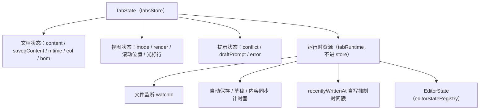
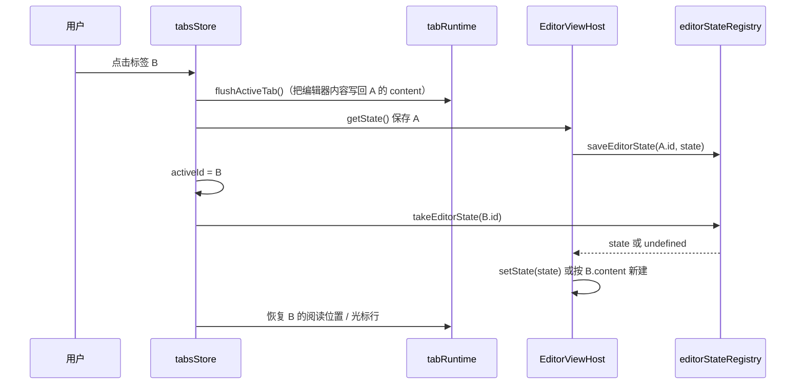

# 窗口多标签设计

| 项目 | 内容 |
| --- | --- |
| 文档版本 | v0.1（草案） |
| 日期 | 2026-10-27 |
| 状态 | 待评审 |
| 上游文档 | [详细设计](./02-detailed-design.md) §3 · §11 · §15 |
| 关联文档 | [测试方案](./03-test-plan.md) · [开发计划](./04-development-plan.md) v1.1 |
| 目标版本 | v1.1 |

## 1. 背景与目标

v0.9.x 的应用是**单文档模型**：一个窗口只有一份文档状态，打开新文件会替换当前文档（有未保存修改时弹确认）。这带来三个具体问题：

1. 在文档之间对照阅读时，每次切换都要重新打开文件，滚动位置丢失。
2. 工作区里点开一篇笔记，正在读的另一篇就被顶掉。
3. 从文档 A 里的相对链接跳到文档 B，想回到 A 只能重新找。

**目标**：在单个窗口内支持多个文档标签，切换时不丢失编辑内容、撤销历史与阅读位置。

**验收标准**

- 同时打开 ≥ 8 个文档，切换任意两个标签，正文内容、光标位置、撤销历史、阅读滚动位置均保持。
- 关闭有未保存修改的标签时，能单独选择保存 / 放弃 / 取消；取消后标签保留。
- 后台标签的外部修改仍能被检测，并在切回时给出冲突提示。
- 打开已打开的文件时激活已有标签，不产生重复标签。
- 打印 / 导出只作用于当前标签，不会串到其他标签的内容。

## 2. 非目标

- **不做多窗口**：一个进程一个窗口是 v0.9.1 的既定行为，本次不改。多窗口另立设计。
- **不做分屏**：左右并排两篇文档不在本次范围（README 已声明不做双栏预览）。
- **不做未命名文档**：没有"新建空白标签"的模型，所有标签都对应磁盘上的文件。`Cmd/Ctrl+T` 是"打开文件到新标签"。
- **不做标签拖拽到窗口外**（分离成新窗口）。
- **不做会话恢复**：标签列表与滚动位置的持久化恢复属于 v1.1 的另一项，本次只保证数据模型不阻碍它（见 §11）。

## 3. 现状与约束

### 3.1 当前的单文档假设

| 位置 | 现状 | 多标签下的问题 |
| --- | --- | --- |
| `src/stores/documentStore.ts` | 单份 `path/content/savedContent/mode/render/...` | 只能容纳一份状态 |
| `App.tsx` `docWatchId` | 单个 ref，打开新文件时 `unwatch` 旧的 | 需要每个标签一个监听 |
| `App.tsx` `autoSaveTimer` / `draftTimer` / `syncTimer` | 单个 ref | 后台标签的输入不会被自动保存 |
| `App.tsx` `recentlyWrittenAt` | 单个 ref | 一个标签保存会抑制另一个标签的外部变更检测 |
| `App.tsx` `conflict` / `draftPrompt` | `useState`，全局一份 | 后台标签的冲突无处显示 |
| `EditorViewHost` | 一个 `EditorView`，`setValue` 会重建 `EditorState` | 重建即丢失撤销历史 |
| `ReaderView` | 单个 `<article>`，`innerHTML` 整体替换 | 切换标签要恢复 DOM 与滚动位置 |
| 打印 / 导出 | `document.querySelector(".md-body")` | 若多个阅读视图同时在 DOM 里会选错 |

### 3.2 不可破坏的既有约束

- **编辑器是活动标签内容的权威来源**（详细设计 §3.2）。禁止在 `updateListener` 里逐键写 store。
- **渲染缓存**（LRU 8）与 **Mermaid SVG 缓存**（LRU 50）已经存在，切标签时命中缓存，不需要新机制。
- **草稿按规范化路径哈希存储**（`drafts/<sha256(path)>.json`），天然是"每文档一份"，与标签无关，不需要改动。
- **打印样式** `print.css` 隐藏应用外壳；新增的标签栏必须一并隐藏。

## 4. 数据模型

### 4.1 标签状态

```ts
// src/stores/tabsStore.ts
export type DocMode = "read" | "edit";
export type DocStatus =
  "loading" | "clean" | "dirty" | "saving" | "conflict" | "error";

export interface TabState {
  /** 稳定 id，与路径解耦：同一路径关闭后重开是新标签。 */
  id: string;
  /** 规范化绝对路径（POSIX 分隔符），与 platform 返回一致。 */
  path: string;
  /** 显示名：文件名（不含扩展名以外的处理），标签栏与窗口标题用。 */
  title: string;

  content: string;
  savedContent: string;
  mtimeMs: number | null;
  eol: Eol;
  bom: boolean;

  mode: DocMode;
  status: DocStatus;
  dirty: boolean;
  render: RenderResult | null;
  error: string | null;

  /** 该标签自己的冲突与草稿提示，不再放在 App 层。 */
  conflict: { diskContent: string; diskMtimeMs: number } | null;
  draftPrompt: { content: string } | null;

  /** 切走时的阅读位置：顶部行 + 像素偏移（行不足以表达图片/表格造成的高度差）。 */
  readLine: number;
  readScrollTop: number;
  /** 切走时的编辑器光标行。 */
  editLine: number;
}
```

### 4.2 标签集合

```ts
interface TabsState {
  tabs: TabState[];
  activeId: string | null;

  openTab(doc: TextDocument, render: RenderResult): string;
  activate(id: string): void;
  close(id: string): void;
  update(id: string, patch: Partial<TabState>): void;
  /** 按路径查已打开的标签，用于去重。 */
  findByPath(path: string): TabState | undefined;
  /** 重新排序（拖拽或"关闭其他"后）。 */
  move(from: number, to: number): void;
}
```

**派生值**：`activeTab = tabs.find(t => t.id === activeId)`。所有原来从 `useDocumentStore()` 解构的字段改为从 `activeTab` 取。

`useDocumentStore` 在迁移完成后删除，避免两份状态并存。

### 4.3 编辑器状态不放进 store

CodeMirror 的 `EditorState` 包含文档、选区与撤销历史，对 1MB 文档可达数 MB，且是不可变的大对象。放进 zustand 会让每次 `set()` 的比较与 devtools 序列化变重。

改为独立注册表：

```ts
// src/features/tabs/editorStateRegistry.ts
const states = new Map<string, EditorState>();

export function saveEditorState(tabId: string, state: EditorState): void;
export function takeEditorState(tabId: string): EditorState | undefined;
export function dropEditorState(tabId: string): void;
/** 大文件标签切走时丢弃，防止内存随标签数线性增长（见 §10）。 */
export function dropIfLarge(tabId: string, contentLength: number): void;
```

## 5. 状态与资源归属

### 5.1 每个标签各自持有的东西



运行时资源放在模块级 `Map<tabId, TabRuntime>`，不进 store：

```ts
// src/features/tabs/tabRuntime.ts
interface TabRuntime {
  watchId: number | null;
  autoSaveTimer: number | null;
  draftTimer: number | null;
  syncTimer: number | null;
  lastWrittenAt: number;
}

export function runtimeOf(tabId: string): TabRuntime;
export function disposeRuntime(tabId: string): Promise<void>; // 清计时器 + unwatch + 丢弃 EditorState
```

**为什么分开**：计时器句柄与 watchId 只在副作用里用，写进 store 会触发无意义的重渲染，也无法序列化。

### 5.2 共享的东西（保持全局）

| 资源 | 归属 | 理由 |
| --- | --- | --- |
| 主题、字号、行高、栏宽、侧栏宽度 | `settingsStore` | 用户级偏好，跨标签一致 |
| 工作区树、搜索索引 | `workspaceStore` | 窗口级，与标签无关 |
| 渲染缓存、Mermaid/Shiki 缓存 | 模块级 LRU | 按内容做 key，天然跨标签复用 |
| 最近文件 / 最近工作区 | `recentsStore` | 用户级 |

## 6. 编辑器：单 EditorView + 状态交换

### 6.1 方案选择

| 方案 | 撤销历史 | 内存 | 切换开销 |
| --- | --- | --- | --- |
| 每标签一个 `EditorView`（DOM 常驻，隐藏） | 天然保持 | N 份 DOM + N 份状态，1MB 文档下迅速膨胀 | 无 |
| 单 `EditorView` + `view.setState()` | **保持**（history 是 `EditorState` 的一部分） | 1 份 DOM + N 份状态 | 一次 `setState`，与文档大小线性相关 |
| 单 `EditorView` + `setValue()`（现状） | **丢失**（重建 state） | 1 份 | 同上 |

选第二种。CodeMirror 官方对多文档场景推荐的正是 `view.setState()`：它替换状态但保留视图实例与 DOM 容器。

### 6.2 EditorViewHost 扩展

```ts
export interface EditorHandle {
  getValue(): string;
  setValue(value: string): void;          // 保留：新文档载入当前标签
  getState(): EditorState;                // 新增：切走前保存
  setState(state: EditorState): void;     // 新增：切回时恢复
  getCursorLine(): number;
  getTopVisibleLine(): number;
  scrollToLine(line: number, focus?: boolean): void;
  focus(): void;
}
```

切换流程：



**关键规则**：切走前必须同步 flush。活动标签的 `content` 可能落后编辑器 300ms（同步去抖），如果不 flush，后台标签的自动保存会写入旧内容。

### 6.3 阅读视图

阅读视图**不常驻**：只有活动标签的 `ReaderView` 在 DOM 中。

- 切换时以 `key={activeTab.id}` 重新挂载，`html` 直接来自 `activeTab.render.html`，无需重新渲染 Markdown。
- 挂载后恢复 `readLine` + `readScrollTop`：先 `scrollToLine(readLine)` 再按像素微调。
- Mermaid 走既有 `svgCache`，同一图重复挂载不重新渲染。

**为什么不让 N 个 `<article>` 常驻**：

1. 打印与导出用 `document.querySelector(".md-body")` 取当前文档，多份 DOM 会导致选错（可改为按 id 取，但下面的原因仍然成立）。
2. 1MB 文档的 DOM 节点数在十万级，N 份常驻会显著推高内存与样式重算成本。

代价是每次切换要重新解析一次 HTML。按 100KB 文档实测约十几毫秒，在切换预算内（§10）。

## 7. 打开、关闭与切换语义

### 7.1 打开

| 入口 | 行为 |
| --- | --- |
| 文件对话框（`Cmd/Ctrl+O`） | 新标签；已打开则激活 |
| 工作区文件树点击 | 新标签；已打开则激活 |
| 搜索结果点击 | 新标签并定位到行；已打开则激活并定位 |
| 文档内相对链接 | **当前标签内替换**；`Cmd/Ctrl+点击` 强制新标签 |
| 文件关联 / macOS `RunEvent::Opened` | 新标签；已打开则激活 |
| 命令行冷启动参数 | 每个路径一个标签，首个为活动标签 |

**去重键是规范化路径**。`platform.readDocument` 返回的 `path` 已是 canonical（Rust 侧 `dunce::canonicalize` + POSIX 分隔符），直接比较即可。

**打开不再需要脏检查**：新标签不会覆盖任何未保存内容。唯一的脏检查在"当前标签内替换"（相对链接点击）时保留。

### 7.2 关闭

```ts
async function closeTab(id: string): Promise<boolean> {
  const tab = find(id);
  if (tab.dirty) {
    const choice = await askSaveDiscardCancel(tab.title); // 保存 / 放弃 / 取消
    if (choice === "cancel") return false;
    if (choice === "save" && !(await saveTab(id))) return false;
  }
  await disposeRuntime(id);        // 计时器 + watcher + EditorState
  await platform.clearDraft(tab.path);
  removeTab(id);
  // 关闭活动标签后激活右侧标签；没有右侧则激活左侧；都没有则回到空状态。
  return true;
}
```

- 关闭最后一个标签 → 显示空状态页，**不退出应用**。
- `Cmd/Ctrl+W` 关标签；窗口关闭仍走标题栏按钮与原生菜单，由 `close_window` 处理（见 §7.3）。
- 关闭标签前若有未落盘的草稿计时器，先 `flush` 再删除草稿，避免"关掉了但草稿还留着"。

### 7.3 窗口关闭

窗口关闭时对所有脏标签逐个确认。为避免连续弹窗打断，采用**一次汇总确认**：

```text
有 3 个标签未保存：a.md、b.md、c.md
[全部保存]  [全部放弃]  [取消]
```

选择"全部保存"时串行保存，任一失败则中止关闭并停在失败的标签上。

### 7.4 后台标签的外部修改

文件监听仍然每标签一个，事件按路径路由：

```ts
platform.onFsChange((event) => {
  const touched = tabs.filter((tab) => event.paths.includes(tab.path));
  if (touched.length > 0) {
    for (const tab of touched) void handleExternalChange(tab.id);
    return; // 不再触发工作区刷新去抖
  }
  scheduleWorkspaceRefresh(); // 既有逻辑
});
```

- 干净的后台标签被外部修改：静默重载内容并重新渲染（用户切回时看到新内容），标签上不打扰。
- 脏的后台标签：在该标签上标记 `conflict`，标签栏显示冲突圆点；切回时展示既有的冲突面板。
- `recentlyWrittenAt` 改为**每标签一份**，否则标签 A 的保存会抑制标签 B 的外部变更检测（现有实现是全局 ref，这在多标签下是正确性 bug）。

## 8. 快捷键与菜单

| 动作 | macOS | Windows / Linux | 说明 |
| --- | --- | --- | --- |
| 打开文件到新标签 | `⌘O` | `Ctrl+O` | 语义不变，落点改为新标签 |
| 关闭当前标签 | `⌘W` | `Ctrl+W` | 最后一个标签时回到空状态，不退出 |
| 下一个 / 上一个标签 | `⌘⇧]` / `⌘⇧[` | `Ctrl+Tab` / `Ctrl+Shift+Tab` | 与浏览器一致 |
| 切换到第 N 个标签 | `⌘1`…`⌘9` | `Ctrl+1`…`Ctrl+9` | 第 9 个为"最后一个标签" |
| 重新打开刚关闭的标签 | `⌘⇧T` | `Ctrl+Shift+T` | 保留最近 10 个 |
| 关闭其他标签 | 菜单项 | 菜单项 | 有脏标签时逐个确认 |

快捷键文案继续走 `src/lib/shortcut.ts`，新增 `closeTab` / `nextTab` / `prevTab` / `reopenTab` 四个 id，保持"只影响文案、监听始终接受 metaKey 或 ctrlKey"的既有约定。

原生菜单 `文件` 下新增：`新建标签（打开文件…）`、`关闭标签`、`重新打开关闭的标签`。菜单事件复用 `app://menu` 通道，action 名为 `close-tab` / `reopen-tab`。

**注意**：macOS 上 `⌘W` 默认由系统关闭窗口。前端需要在 `keydown` 里 `preventDefault` 并阻止冒泡，同时原生菜单不要给"关闭窗口"绑定 `⌘W`。

## 9. 界面

### 9.1 布局

标签栏位于应用标题栏与工作台之间，高度 34px：

```text
┌──────────────────────────────────────────────────────────┐
│ 墨 墨览        笔记.md · 墨览        [打开][源码][保存]… │  titlebar
├──────────────────────────────────────────────────────────┤
│ ● 笔记.md × │ 设计.md ● × │ 会议.md × │            ＋    │  tab-bar（新增）
├───────────┬──────────────────────────────────────────────┤
│  工作区    │                                              │
│  文件树    │              阅读 / 源码视图                  │
│           │                                              │
├───────────┴──────────────────────────────────────────────┤
│ ● 已保存                                    1,234 字 · 3 分钟 │  statusbar
└──────────────────────────────────────────────────────────┘
```

- 每个标签：状态圆点（脏 = 实心、冲突 = 红色、无修改 = 隐藏）、文件名、关闭按钮（hover 或激活时显示）。
- 溢出：标签栏横向滚动，不换行、不压缩到不可读；当前标签自动滚入视野。
- `＋` 按钮 = 打开文件到新标签。
- 应用标题栏的 `.doc-title` 与窗口标题显示活动标签的标题（`标题 · 墨览`），行为不变。

### 9.2 可访问性

- 容器 `role="tablist"`，标签 `role="tab"` + `aria-selected` + `aria-controls`，面板 `role="tabpanel"`。
- 左右方向键在标签间移动焦点（roving tabindex），`Delete` 关闭当前标签。
- 标签关闭按钮 `aria-label="关闭 笔记.md"`，不与标签本体的可访问名冲突。
- 冲突圆点带 `aria-label`，不能只靠颜色表达。

### 9.3 打印与导出

`print.css` 增加 `.tab-bar { display: none }`。导出继续取当前 DOM 中唯一的 `.md-body`（§6.3 保证只有一份）。

## 10. 性能与内存预算

| 指标 | 目标 | 说明 |
| --- | --- | --- |
| 标签切换（100KB 文档） | < 50ms | 含 flush、EditorState 交换、阅读视图重挂载 |
| 标签切换（1MB 文档） | < 300ms | 阅读视图重建为主，走大文件模式 |
| 8 个 100KB 标签常驻 | < 150MB 增量 | 每标签 content + render.html + EditorState |
| 后台标签自动保存 | 不阻塞前台输入 | 写入在 Tauri 命令线程，前端不等待 |

**大文件保护**：内容 > 2MB（即进入大文件模式的文档）切走时，`dropIfLarge` 丢弃其 `EditorState`，切回时按 `content` 重建，撤销历史丢失并给出一次提示（"大文件标签切换后不保留撤销历史"）。这是内存与体验的显式取舍。

**缓存容量**：渲染缓存当前 LRU 8，标签数超过 8 时切回旧标签会重新渲染。可提到 16，代价约 16 × render.html（100KB 文档约 300KB 字符串）。建议保持 8，先测再调。

## 11. 为会话恢复预留

本次不做恢复，但数据结构需支持：

- `TabState` 的持久化子集：`{ path, mode, readLine, readScrollTop, editLine }`，不含 content（从磁盘重新读）。
- 恢复时机：应用启动后、`takePendingOpen` 之前；若有命令行/文件关联路径，优先打开它们并跳过恢复。
- 存储位置：`localStorage` 键 `marklook.tabs`，与 `marklook.settings` / `marklook.recents` 并列。

## 12. 测试计划

### 12.1 单元（Vitest）

| 用例 | 断言 |
| --- | --- |
| `openTab` 新路径 | 追加到末尾并激活 |
| `openTab` 已打开路径 | 不新增，激活已有标签 |
| `closeTab` 活动标签 | 激活右侧；无右侧则左侧；无标签则 `activeId = null` |
| `closeTab` 非活动标签 | 活动标签不变 |
| `update` 只影响目标标签 | 其他标签对象引用不变 |
| `move` 重排 | 顺序正确，`activeId` 不变 |
| 脏状态计算 | `content !== savedContent` 时 dirty |

### 12.2 E2E（Playwright）

| 用例 | 断言 |
| --- | --- |
| 打开两个文件得到两个标签 | 标签栏出现两项，第二个为激活 |
| 切换标签保持阅读位置 | 在 A 滚到中部 → 切 B → 切回 A，顶部行与切换前一致 |
| 切换标签保持撤销历史 | 在 A 输入 → 切 B → 切回 A → `Cmd/Ctrl+Z` 撤销生效 |
| 关闭脏标签弹出三选一 | 取消后标签仍在；放弃后消失 |
| 关闭最后一个标签 | 显示空状态，应用不退出 |
| 重复打开同一文件 | 只有一个标签 |
| 后台标签自动保存 | A 输入后切到 B，等待 1s 后 A 的 Mock 内容已更新 |
| 后台标签外部修改 | 切回时出现冲突面板，标签栏有冲突标记 |
| 打印/导出只含当前标签 | 导出 HTML 中不含另一标签的标题 |
| 标签栏可访问性 | axe 扫描无 critical/serious；方向键可切换 |

### 12.3 门禁

- 现有 E2E 全部改为经标签栏操作（打开文件后先断言标签出现），避免"单文档假设"残留。
- `tests/unit/platformContract.test.ts` 不受影响（平台层接口不变）。
- Rust 侧无改动，cargo 门禁保持。

## 13. 迁移步骤

分五步落地，每步结束时代码可运行、门禁全绿。


| 阶段 | 内容 | 估算 |
| --- | --- | --- |
| P1 | 把 App.tsx 里的文档逻辑抽成 `useDocumentSession`，`DocumentPane` 组件持有 reader/editor refs；仍只有一个会话 | 1.5 人日 |
| P2 | `tabsStore` + 标签栏；`EditorViewHost` 增加 `getState/setState`；阅读视图按标签 key 重挂载 | 1.5 人日 |
| P3 | `tabRuntime`：每标签 watcher 与计时器；冲突/草稿提示下沉到标签 | 1 人日 |
| P4 | 快捷键、原生菜单项、`app://open-paths` 改为开新标签 | 0.5 人日 |
| P5 | 溢出滚动、重开关闭的标签、可访问性、关闭其他 | 1 人日 |
| 测试 | 单元 + E2E + 手动矩阵 | 1 人日 |

**为什么先做 P1**：当前 `App.tsx` 有 1,500 行，文档逻辑与 UI 交织。直接在原文件上加标签会让每一步都难以 review。抽出 `DocumentPane` 后，标签化只是"渲染 N 个 pane、只有一个可见"的外层问题。

## 14. 风险

| 风险 | 影响 | 应对 |
| --- | --- | --- |
| `view.setState()` 在某些扩展上表现异常（如 IME 组合中输入时切换） | 输入丢失或崩溃 | 切换前 `blur` 并结束组合；E2E 覆盖 IME 用例 |
| 每标签一个 watcher 在大量标签时耗尽句柄 | 监听失败 | 同目录监听去重（见下）；失败降级为焦点刷新 |
| 后台标签自动保存与前台输入争用主线程 | 输入卡顿 | 保存已在 Tauri 命令线程；前端只做内容快照 |
| 关闭标签时草稿与未保存内容混淆 | 数据丢失 | 关闭前强制 flush + 明确三选一；草稿在确认后才删除 |
| 阅读视图重挂载导致 Mermaid 闪烁 | 体验 | 命中 svgCache 时同步注入，无占位闪烁；必要时给占位块加 `min-height` |
| 大文件标签的 EditorState 内存 | OOM | §10 的 `dropIfLarge` 策略 |

**同目录监听去重**（可选优化，P3 视情况做）：多个标签在同一目录时，注册一个按目录的监听，前端按路径分发到标签。需要 Rust 侧支持"不按 targetFile 过滤"的模式——现有 `watch_paths` 传 `markdownOnly: false` 且不传 `targetFile` 即可获得目录全量事件，前端自行路由。收益是句柄数从 N 降到"不同目录数"。

## 15. 开放问题

1. **相对链接的默认落点**：当前设计为"替换当前标签"，`Cmd/Ctrl+点击` 新标签。若用户更习惯浏览器式的"链接总是新标签"，需要调整——但这会让阅读长文时标签迅速膨胀。倾向保持替换，待试用反馈。
2. **标签栏位置**：放在应用标题栏下方（本设计）还是并入标题栏右侧（更省纵向空间，但 macOS 标题栏已有窗口控制按钮）。倾向独立一行，实现简单且跨平台一致。
3. **`⌘W` 语义**：macOS 用户可能预期 `⌘W` 关窗口。VS Code、Safari 的 `⌘W` 都是关标签，本设计跟随这一惯例；关窗口用 `⌘⇧W`（后续可加）。
4. **标签上限**：是否设硬上限（如 30）防止极端情况。倾向不设硬上限，靠大文件保护与用户习惯约束。
